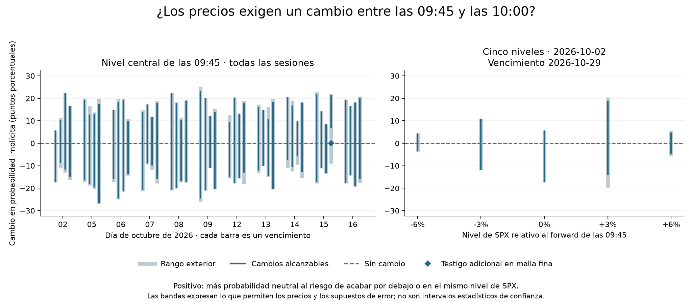

# ¿Cambió la distribución implícita de SPX entre las 09:45 y las 10:00?
3 de noviembre de 2026 · Investigación retrospectiva · Datos: USD 0

**En 44 de 44 comparaciones, las cotizaciones son compatibles con que la
probabilidad implícita sea la misma a las 09:45 y a las 10:00 en los cinco
niveles de SPX a la vez.** Por eso no usaríamos esta medición para cambiar
una posición. No significa que la distribución entera haya permanecido fija.

## Qué se compara

Se usan las mismas once sesiones de octubre del estudio anterior, con dos fotos
por sesión y opciones europeas SPXW de liquidación PM. No se sustituyen
vencimientos ausentes por un número de días parecido. Tampoco se usa un dato
del segundo corte para elegir el umbral del primero. Es una pregunta nueva a
datos ya analizados, no un nuevo conjunto de sesiones prospectivas.

En cada fecha y vencimiento, el forward estimado a las 09:45 fija cinco niveles
absolutos de SPX: 94%, 97%, 100%, 103% y 106% de ese forward. A las 10:00
se expresa **el mismo nivel absoluto** en las unidades internas del modelo.
Si, por ejemplo, un umbral vale 100 y el forward pasa de 100 a 102, en el
segundo cálculo el umbral es 100/102, no 1. También se mantiene el ancho
absoluto de las rampas que sirven para acotar la probabilidad.

La cantidad medida es el cambio en la probabilidad **neutral al riesgo** de
que el SPX termine en o por debajo de ese nivel al vencimiento. Un aumento de
esa probabilidad es un cambio local de la distribución implícita; por sí solo
no predice el retorno físico del índice ni la ganancia de un contrato.

## Cuándo identificamos una dirección

Se conservan las filas de entrenamiento, el forward, descuento, soporte y
presupuesto de error de cada corte del [experimento anterior](RUIDO_CONCENTRADO_2026-10-26.md).
El caso principal mantiene el tope por cotización y el mínimo error medio
L1 más 0.1 spreads. No se escoge un nuevo ajuste porque dé un cambio atractivo.
Las referencias financieras pueden diferir entre horas: lo fijo es el precio
terminal sobre el que preguntamos, no el forward de las dos distribuciones.

Si la CDF de las 09:45 está entre A y B y la de las 10:00 entre C y D, la
banda exterior para su diferencia es **[C − B, D − A]**. Si toda queda
por encima o por debajo de cero, el signo está identificado bajo los supuestos
probados. Si contiene cero, eso solo indica que la cota exterior no descarta
la ausencia de cambio. Para ir más lejos, comprobamos:

1. **Un nivel a la vez.** Construimos dos distribuciones factibles, una por
   corte, que asignan la misma probabilidad en ese nivel si se solapan los
   rangos efectivamente alcanzables. El verificador reconstruye sus precios
   de opciones, también cuando el forward y el descuento pueden variar.
2. **Los cinco niveles juntos.** Buscamos un único par de distribuciones por
   fecha y vencimiento que minimice la mayor diferencia absoluta de las cinco
   CDF. Una solución con diferencia menor o igual a 0.0000001 en probabilidad,
   y medidas verificadas, demuestra igualdad numérica en esos niveles. Una
   distancia positiva obtenida en una malla no demostraría por sí sola que
   no exista otro par en soporte continuo.

El segundo contraste es más exigente: coincidir en cada punto utilizando
distribuciones distintas no garantiza poder coincidir en todos con el mismo
par. No se impone una dinámica entre las dos fotos ni entre vencimientos.
Las bandas son conjuntos de valores compatibles, no intervalos de confianza
del 95%.

## Resultados

Se emparejaron **11 sesiones, 44 combinaciones fecha–vencimiento, 220
comparaciones puntuales**, sin vencimientos huérfanos. El plazo fue de unos
27–33 días. Son cuatro vencimientos por sesión, no 44 sesiones independientes.
En 219 de los 220 casos, el nivel de precio estaba dentro del rango de strikes
de entrenamiento en ambas fotos. El restante fue el +6% del 6 de octubre,
vencimiento 4 de noviembre; excluirlo no cambia la conclusión.

| Grupo de sesiones | Pares | Niveles | Signo identificado | Pares con igualdad simultánea, tras el control |
|---|---:|---:|---:|---:|
| 2–9 octubre | 24 | 120 | 0 | 24 |
| 12–16 octubre | 20 | 100 | 0 | 20 |
| **Total** | **44** | **220** | **0** | **44** |

**Ejemplo.** El 2 de octubre, con vencimiento el 29 y al precio de referencia
inicial, el cambio compatible va de **−17.32 a +5.73 puntos porcentuales**.
Ambos sentidos y el cero se alcanzan bajo el modelo. El ejemplo es la primera
fecha y el primer vencimiento ordenados, sin seleccionar por magnitud.

| Nivel respecto al forward de las 09:45 | Ancho mediano del rango exterior de cambio (puntos porcentuales) |
|---|---:|
| −6% | 13.14 |
| −3% | 23.88 |
| 0% | 33.86 |
| +3% | 40.41 |
| +6% | 12.24 |

Los números son anchos entre extremos, no cambios observados. En el nivel
central el ancho mediano es 29.07 puntos con presupuesto más estricto, 38.17
con F/D variables y 38.65 con margen uniforme, frente a 33.86 en el principal.
Ninguno de esos tres controles identifica un signo en los 220 casos.

### El caso que parecía distinto

En la malla inicial, 219/220 niveles admitían un cambio nulo construido y
43/44 pares lo admitían en los cinco niveles juntos. El **15 de octubre,
vencimiento 17 de noviembre**, el rango exterior central era [−9.00, +22.05]
puntos, pero en la malla discreta el menor cambio central alcanzado era +6.96.
Eso dejaba el caso **indeterminado**: la malla no permitía certificar el cero,
y la banda exterior tampoco permitía afirmar un aumento.

Aplicamos un **control exploratorio posterior**, separado del protocolo inicial,
solo a ese par. Se conservaron todos los nodos anteriores y se añadieron
estados a ambos lados de cada umbral, a una distancia del 0.001% del forward
inicial. No se borraron precios ni se cambiaron sus márgenes de error. Una
relajación con rampas calcula una cota inferior para la distancia conjunta;
dos medidas en la malla ampliada dan una cota superior efectivamente alcanzada.
La cota inferior fue cero y la diferencia máxima alcanzada en el caso principal
fue **2.2e−16 en probabilidad**. También se reconstruyó el cero numérico con
los otros tres supuestos de error para ese par. La separación de 6.96 puntos
era una limitación de la malla inicial, no una señal del mercado.

## Interpretación y siguiente decisión

No usaría el signo de este cambio para elegir un call, aumentar la posición
ni asignar una confianza diaria. Para cada fecha y vencimiento existe un par
compatible de distribuciones que reparte la misma probabilidad en los seis
intervalos delimitados por los cinco niveles. Aun así, la masa **puede moverse
dentro** de cada intervalo. No hemos probado igualdad de toda la distribución
ni que el transporte sea cero, y tampoco hemos contrastado retornos futuros.
Dividir estas bandas por 15 minutos da una banda de tasas medias con la misma
ambigüedad de signo; dos fotos no miden una derivada instantánea.

El siguiente experimento que sí haría con presupuesto cero es medir un cambio
más directamente observable: la **diferencia de precio de dos puts de strikes
fijos** y del mismo vencimiento. Dividida por la distancia entre strikes y por
el descuento, esa diferencia representa la CDF neutral al riesgo promediada
entre esos strikes: el payoff diferencial es la integral de los indicadores
de terminar por debajo de cada nivel. Trabajaríamos con bandas bid/ask y los
mismos strikes en ambas fotos, sin inferir una PDF puntual. Si esas bandas
tampoco distinguen el signo, dejaría esta señal de 15 minutos en observación.
La relación entre el precio del put europeo según su strike y la CDF se
explica en el [Staff Report 677 de la Reserva Federal de Nueva York](https://www.newyorkfed.org/medialibrary/media/research/staff_reports/sr677.pdf).

## Evidencia y reproducción

Protocolo registrado en `4d8965d` antes de calcular los cambios. Se conservan
las limitaciones del piloto: cotizaciones indicativas, referencia de SPX
implícita y selección heredada de filas con IV finita. La comparación usa
los presupuestos publicados por corte; los contratos reservados no se agregan
al ajuste. No se actualizaron la captura ni el simulador de contratos.

Pasaron **42 pruebas** de los tres módulos implicados, incluidas nueve del
contraste temporal. Se resolvieron 7,040 LP marginales y 44 conjuntos en la
corrida principal y sus controles prefijados, más ocho LP para investigar
el caso de la malla. Se reconstruyeron 876 mezclas puntuales de cambio nulo
en los cuatro supuestos iniciales y los cuatro pares de medidas del control
posterior. La mayor discrepancia entre sus cinco CDF reconstruidas fue
4.44e−16 en probabilidad. Esto comprueba factibilidad numérica; no valida el
feed ni demuestra capacidad predictiva.

[Código y comandos de reproducción](../experiments/cambio_cdf_20261103/README.md) ·
[Resultados por fecha y vencimiento](../experiments/cambio_cdf_20261103/resultados/por_vencimiento.json) ·
[Resumen](../experiments/cambio_cdf_20261103/resultados/resumen.json) ·
[Verificación independiente](../experiments/cambio_cdf_20261103/resultados/verificacion.json) ·
[Resultado combinado tras el control de malla](../experiments/cambio_cdf_20261103/resultados/verificacion_control.json).
