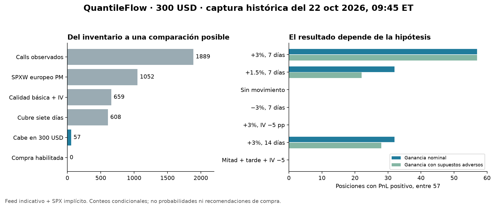

# QuantileFlow: contratos observados con US$300

Fecha del análisis: **6 de noviembre de 2026**. Captura: **22 de octubre de 2026,
09:45 de Nueva York**. Es la última sesión de las tablas locales verificadas
para este trabajo; no se afirma que sea la captura más reciente de GitHub.

## Resultado y decisión

El comparador ya lee contratos de una captura histórica. De 1,889 calls
observados, 57 SPXW permiten una comparación exploratoria con US$300 y un
horizonte de siete días. **Ninguno queda habilitado como recomendación de compra.**
El feed es indicativo y SPX se referencia mediante paridad, sin una observación
independiente del índice. Además, ningún ganador de los siete escenarios se
separa de todas las bandas de sus rivales.

El presupuesto sí cambia el tipo de opción al que accedemos: los 57 candidatos
vencen entre **28.30 y 33.30 días** desde la captura y sus strikes están entre
**6.84% y 18.28% por encima de la referencia SPX**. No estamos comparando la misma
clase de posiciones que en el ejemplo sintético con subyacente de US$100.



## Qué observamos

| Etapa, en orden | Calls restantes |
|---|---:|
| Captura, SPXW y SPY | 1,889 |
| SPXW europeo PM, instrumento admitido | 1,052 |
| Calidad básica e IV bid/mid/ask identificables | 659 |
| Vencimiento posterior al horizonte de siete días | 608 |
| Al menos un contrato cabe con entrada y cierre | 57 |
| Compras habilitadas para operar | 0 |

SPY aporta 837 calls; 200 caben nominalmente antes de filtrar calidad. Se
excluyen del cálculo por ejercicio americano: este adaptador no valida todavía
su tratamiento con dividendos. El repositorio ya contiene un árbol americano,
pero su existencia no equivale a haber validado este flujo con esos contratos.

La disponibilidad de contratos depende de la ventana recolectada. Estos números
no describen todo el universo de opciones cotizadas. Se conserva el multiplicador
de 100: no se abaratan contratos cambiando su unidad.

## Qué ocurre si cambia la hipótesis

Cada fila compara las **mismas 57 compras**, con su cantidad entera inicial fija.
La cantidad es el máximo que cabe, limitada por el tamaño ask publicado. En la
interfaz A/B también se puede elegir menos cantidad y conservar efectivo.

| Salida hipotética | Compras con ganancia nominal | Con ganancia en extremo inferior de banda |
|---|---:|---:|
| +3% en 7 días, IV constante | 57 | 57 |
| +1.5% en 7 días, IV constante | 32 | 22 |
| Sin movimiento, 7 días | 0 | 0 |
| −3% en 7 días | 0 | 0 |
| +3% en 7 días, IV cae 5 puntos | 0 | 0 |
| +3% en 14 días, IV constante | 32 | 28 |
| +1.5% en 14 días, IV cae 5 puntos | 0 | 0 |

**57/57 no es una probabilidad de ganar.** Son resultados del modelo al imponer
una subida y una trayectoria de IV concreta. Los escenarios no tienen pesos ni
frecuencias estimadas. El resultado muestra que acertar la dirección no basta:
una caída de IV puede eliminar la ganancia hipotética aunque el índice suba.

El ganador nominal cambia cuando el +3% llega en 14 días. En los siete escenarios,
ninguna compra tiene su banda inferior por encima de las bandas superiores de
todas las demás y del efectivo. Esto no demuestra que todos los contratos sean
iguales: demuestra que este contraste no distingue un ganador inequívoco bajo
los supuestos examinados. El efectivo se incluye con rendimiento cero.

Control adicional de presupuesto, manteniendo los mismos filtros e hipótesis:
US$100 permite 24 candidatos; US$200, 45; US$300, 57; US$500, 73.
Es sensibilidad de cobertura; no una sugerencia de aumentar capital.

## Cómo se construye cada mapa

1. Se elige una sola captura y únicamente información disponible al corte.
   El SIP de SPY recibido/publicado después no entra como referencia de decisión.
2. Se descartan cotizaciones sin bid positivo, tamaños insuficientes, precios
   inválidos, sellos futuros/ausentes, edad mayor a 60 segundos y spread relativo
   mayor a 50%. Son filtros exploratorios explícitos, no garantías de ejecución.
3. Se calcula el plazo exacto hasta la liquidación PM con el calendario bursátil,
   incluyendo horario de verano y cierres anticipados. Se admiten hasta 90 DTE.
4. Se invierte Black–Scholes separadamente para bid, mid y ask de **cada contrato**.
   La tasa de 4% y el dividendo continuo de 1.3% son supuestos heredados del piloto.
   Una IV que no se puede identificar causa exclusión; no se rellena.
5. Se compra al ask de esa captura y se reserva US$0.65 por contrato y lado.
   La cantidad máxima es:

   `min(floor(capital_arriesgable / (100 × ask + 2 × comisión)), tamaño_ask, límite_usuario)`.

6. En cada celda se fija el nuevo nivel del índice, se resta el tiempo transcurrido
   y se aplica el choque de IV a la IV inicial del contrato. La entrada y cantidad
   nunca se recalculan al cambiar la salida. El valor nominal de salida es el
   precio teórico menos un semispread observado, con piso cero.
7. La banda inferior usa IV bid y dos semispreads de salida; la superior, IV ask
   y un semispread. Se repite el mapa para choques de −5, 0 y +5 puntos de IV
   alrededor del choque introducido por el usuario. **No es un intervalo de
   confianza** y no cubre todos los errores posibles de datos o modelo.
8. Si ya venció, el resultado es ausente: el precio futuro posterior no permite
   reconstruir su liquidación. Exactamente al vencer se usa payoff y comisión,
   sin spread. Una IV no positiva también deja ausente la celda antes de vencer.

Los días del mapa son naturales; una celda es una valoración hipotética, no una
promesa de negociación en día hábil. No se simula la ejecución de una orden.
La banda de salida no incorpora deterioro adicional del ask de entrada.

### Qué superficie es ésta

Es una **superficie de ganancias y pérdidas de una compra fija**. No es una PDF,
una superficie SSVI ni una reconstrucción sin arbitraje del mercado. Ajustar una
IV por contrato reproduce su mid al inicio, pero no prueba coherencia entre
strikes ni cómo se moverá la sonrisa de volatilidad en el futuro. El choque
paralelo de IV es un escenario, no una dinámica calibrada.

Los valores detallados por contrato, sus mapas y las exportaciones se conservan
en almacenamiento local privado. GitHub recibe código, conteos y resúmenes.

## Uso y código

Arrancar con una normalización local cuyo manifiesto esté intacto:

```text
python scripts/simulador_opciones.py --tablas-observadas RUTA_TABLAS_PRIVADAS --fecha-observada 2026-10-22 --hora-observada 09:45
```

Abrir `http://127.0.0.1:8791/observadas`. El ejemplo sintético conserva su propia
página. El modo observado permite cambiar presupuesto, plazo, movimiento e IV;
seleccionar dos series y cantidades exactas; ver mapas y descargar el análisis
privado. Si no hay captura o no hay candidatos, se informa sin fabricar resultados.

El servidor verifica todas las huellas de las tablas antes de cargarlas. La
petición HTTP no acepta rutas del sistema; sólo utiliza la captura configurada
al arrancar. Se mantienen los controles de acceso local y de origen.

- Adaptador y simulación: `quantileflow/observadas.py`.
- Interfaz: `apps/simulador/observadas.html` y `observadas.js`.
- Experimento reproducible y auditor: `experiments/observadas_20261106/evaluar.py`.
- Resultados agregados: `experiments/observadas_20261106/resultados/resumen.json`.

## Comprobaciones

- **99 pruebas** del comparador observado, simulador previo, A/B, escenarios,
  posiciones y comparador PDE. Incluyen presupuesto, tamaño, efectivo, IV,
  vencimiento, exclusiones, disponibilidad temporal y acceso HTTP.
- **33 manifiestos y 109 páginas crudas** pasan sus huellas, incluyendo contenido
  descomprimido; también las tablas de la normalización.
- **171 inversiones de IV** contrastadas con otra implementación de la CDF normal.
- **27,702 celdas numéricas** comprobadas con `math.erf`, independiente del `ndtr`
  del motor, y caja calculada nuevamente. Error absoluto máximo: `2.87e-9`.
- **9,234 celdas ausentes** verificadas: no se sustituyen por cero.
- Interfaz observada verificada en Edge: 57 candidatos, selección A/B y cantidades,
  mapas, descarga privada, ausencia de candidatos, invalidación de resultados y
  pantallas de 320/375 píxeles. También pasa la prueba previa del simulador sintético.
- La auditoría de fórmulas confirma la implementación bajo estos supuestos;
  **no valida que el modelo describa futuros precios de mercado**.

## Qué sigue y por qué

El problema encontrado tiene tres partes: selección forzada hacia strikes lejanos
por presupuesto/universo recolectado; incertidumbre en precios y referencia; y
dependencia fuerte de la dinámica futura de IV. Corregir aritmética no elimina
esos tres problemas, y datos mejores sólo abordan una parte.

El siguiente trabajo útil, sin comprar datos, es validar el **adaptador americano
para SPY** usando el árbol existente, dividendos disponibles al corte y controles
de convergencia. Después se puede repetir esta comparación y verificar si un
subyacente de menor nominal mejora la cobertura con US$300. Debe conservarse el
bloqueo de ejecución mientras el feed siga siendo indicativo. Otro control útil
será perturbar la referencia y la dinámica de IV; todavía no se han incorporado
a las bandas de este experimento.

No se modificó la captura diaria, no se contrató un feed y no se enviaron órdenes.

## Fuentes de las convenciones

Alpaca explica que el feed indicativo deriva de OPRA y sus cotizaciones no son
cotizaciones OPRA reales: [Historical Option Data](https://docs.alpaca.markets/us/docs/historical-option-data).
La especificación SPX/SPXW documenta ejercicio europeo, liquidación en efectivo
y multiplicador de 100: [Cboe SPX specifications](https://www.cboe.com/tradable-products/sp-500/spx-options/spx-specifications).
