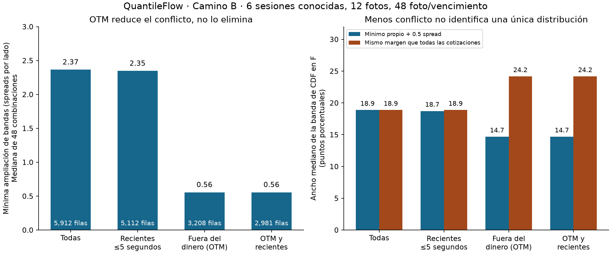
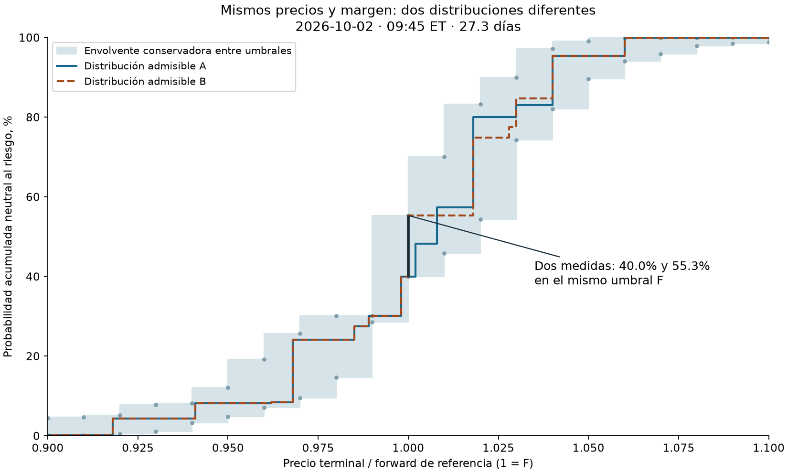

# QuantileFlow — camino B: cuánto sabemos de la distribución
Fecha: 22 de octubre de 2026. Gasto en datos: **USD 0**.

## Qué preguntamos

La revisión anterior mostró que ninguna de las 48 combinaciones de foto y
vencimiento admite todos los bid/ask originales bajo las restricciones europeas
comprobadas. Una curva más flexible no puede arreglar esa contradicción.

Ahora preguntamos: **al permitir un error de cotización explícito, ¿queda una
distribución bien determinada o muchas distribuciones distintas?**

Construimos conjuntos de medidas neutrales al riesgo admisibles. No escogemos
una PDF suave como si fuera la verdadera. La salida útil son rangos y ejemplos
concretos de cómo pueden diferir dos distribuciones compatibles.

## Datos y alcance

Mismo snapshot: seis sesiones del 2 al 9 de octubre, doce capturas y cuatro
vencimientos por captura cercanos a 30 días. No son 48 días independientes.
Se usan las 5,912 filas de training de SPXW europeo en la ventana amplia
de log-moneyness ±0.10 del estudio anterior.

Los contratos reservados no intervienen en la reparación ni en la construcción
de las bandas. Se usan después para un contraste de compatibilidad, pero ya
habían sido examinados en estudios anteriores: **no son un test nuevo**.

Se mantienen las exclusiones heredadas, incluidas 714 filas del ensayo amplio
con IV no finita. Estos resultados no abarcan todas las filas originales,
las sesiones nuevas ni vencimientos muy cortos.

## Modelo de error y método

Para cada cotización, s = ask − bid. Permitimos que el precio coherente esté en:

    [bid − rho × s, ask + rho × s]

Primero buscamos el menor rho compatible con una medida no negativa, masa total
uno, media financiera declarada y todos los payoffs europeos seleccionados.
Después probamos márgenes adicionales de 0.1, 0.5 y 1 spread por lado.

Es un **modelo de error acotado**, no una estimación de la distribución del ruido.
El rho mínimo es el menor ajuste que permite encajar; no es necesariamente el
error verdadero. Los márgenes son sensibilidades predefinidas, no niveles
de confianza del 90% o 95%.

Para cada nivel K calculamos límites de Q(S_T ≤ K), usando:

- una rampa que queda por debajo del indicador y otra que queda por encima;
- medidas que minimizan y maximizan esas esperanzas;
- un control adicional que optimiza la CDF exacta sobre los estados declarados,
  para exhibir diferencias realmente alcanzadas por dos medidas admisibles.

El soporte principal es [0, 2F] y se repite con [0, 4F]. F es el forward de
referencia. La rampa tiene ancho 0.25% de F; también se prueba 0.125%.
No se supone una lognormal, SSVI ni una red neuronal.

El LP incorpora los strikes y todos los quiebres de los payoffs y rampas.
Mover masa interior a los extremos de cada tramo, conservando su media,
preserva esas esperanzas. Por eso la reducción finita es exacta para esas
funciones continuas y ese soporte. El indicador discontinuo de la CDF se trata
por separado: las rampas dan cotas exteriores; las dos medidas discretas dan
posibilidades alcanzadas, sin afirmar extremos globales de la CDF.

## Resultado: limpiar por antigüedad cambia poco

| Selección de training | Filas | Ajuste mínimo mediano, spreads | Mayor ajuste | Sin reparar |
|---|---:|---:|---:|---:|
| Todas | 5,912 | 2.365 | 17.425 | 0/48 |
| Recientes, hasta 5 segundos | 5,112 | 2.346 | 17.425 | 0/48 |
| Fuera del dinero, OTM | 3,208 | 0.556 | 3.484 | 1/48 |
| OTM y recientes | 2,981 | 0.556 | 3.484 | 1/48 |

La edad se calcula con información disponible al recibir la cotización:
recibido − evento entre cero y cinco segundos, y disponibilidad no posterior
a recibido. No se usan precios futuros para decidir qué conservar.

OTM usa calls con K≥F y puts con K<F. El ancla F viene del training central
anterior y queda fijada. No se escogen los contratos por su error ajustado.

OTM reduce mucho la contradicción, pero todavía necesita corregir 47 de las
48 combinaciones. Parte de la mejora viene de dejar de exigir que ambos lados
call/put expliquen conjuntamente el mismo strike. **No demuestra que OTM sea
la verdad ni que el problema provenga únicamente del proveedor.**

## Resultado: todavía hay mucha ambigüedad

Con todas las cotizaciones y rho mínimo + 0.5 spreads, la anchura mediana de
la banda exterior en K=F es **18.88 puntos porcentuales**. El máximo es
48.72 puntos. Con solo OTM y su propio mínimo + 0.5, la mediana baja a
**14.67 puntos**, y el máximo es 25.93.

No es solo una holgura de las cotas: las dos medidas construidas alcanzan
diferencias reales de **18.46 puntos en mediana** en el caso principal y
**14.34 puntos** con OTM y margen propio. La ambigüedad queda exhibida por
distribuciones completas que satisfacen las restricciones declaradas.

Los márgenes adicionales de 0.1 y 1 spread producen anchuras medianas de
16.68 y 20.91 puntos, respectivamente. No elegimos el margen que dé una
probabilidad atractiva.

Hay una distinción esencial al comparar filtros:

- Con el mismo margen de error original, quitar cotizaciones elimina
  restricciones. La banda OTM se **ensancha** a una mediana de 24.16 puntos.
- Con el margen menor calculado solo con OTM, la banda se estrecha a 14.67.
  Esa mejora combina descarte de información y un supuesto de menor error.

La primera foto y el primer vencimiento se eligieron para ilustrar el método
antes de ver cuál quedaba más vistoso. La envolvente es puntual: sus extremos
pueden pertenecer a medidas distintas en cada umbral. Las dos curvas completas
sí corresponden a dos medidas admisibles, elegidas por sus valores en F.
Los saltos son soluciones extremas del LP; no evidencia de picos reales en el mercado.
En ese ejemplo, las medidas dan **40.0% y 55.3%** en el mismo umbral F.
Entre umbrales evaluados, el sombreado usa monotonía para conservar cotas,
sin interpolar linealmente probabilidades que no se han acotado directamente.

## Controles económicos y de construcción

El principal fija F y D a las anclas anteriores. Un control permite simultáneamente
F±0.25% y una tasa implícita ±1 punto porcentual. Son bandas de sensibilidad
económica elegidas, no intervalos estimados.

Ese control reduce el mínimo ajuste mediano a 1.738 spreads. A igual tolerancia
de precios que el caso principal, la banda exterior mediana en F aumenta a
19.59 puntos. Permitir más referencias no añade identificación.

Duplicar el límite del soporte de 2F a 4F cambia las cotas centrales como máximo
0.026 puntos porcentuales en los umbrales probados. Eso reduce la preocupación
por ese truncamiento en este ejercicio; no certifica el resultado sin límite
de soporte. La rampa más fina puede cambiar alguna cota hasta 2.20 puntos.
Variar F/D puede cambiar alguna cota hasta 12.58 puntos: las referencias importan.

## Contraste con contratos reservados

Se seleccionan, sin mirar sus precios, los tres calls reservados más próximos
a K/F=0.97, 1 y 1.03 por vencimiento: 144 contratos.

- Caso principal: el intervalo de valoración solapa el bid/ask original en
  123/144; en 21 ni siquiera solapa.
- OTM con margen propio: solapa en 119/144; en 25 no solapa.
- La mediana del ancho medio por rebanada equivale a 4.54 spreads en el principal
  y 3.11 en OTM.

Solapar una banda no es acertar un precio. Los intervalos pueden ser amplios y
el holdout comparte el mismo feed ruidoso. Este contraste no mide rentabilidad,
probabilidad física ni exactitud frente a precios ejecutables.

## Qué haría después y por qué

**No usaría todavía una única PDF para mostrar confianza ni para diferenciar
su transporte como si los pequeños cambios fueran información identificada.**
Bajo estos supuestos, hay demasiada dependencia de la reparación y las referencias.

Sí conservaría este motor de conjuntos admisibles como diagnóstico. El siguiente
experimento sería comparar el error uniforme actual con un error concentrado en
pocos contratos, mediante un presupuesto de desviación L1 y un límite máximo.
El trabajo anterior encontró ajuste medio pequeño junto a errores extremos grandes;
el modelo uniforme puede estar ampliando demasiado todas las bandas por unos
pocos conflictos. Esto es una hipótesis a contrastar, no una corrección aprobada.

Antes de promover un filtro o modelo de ruido:
1. Fijar su regla y tolerancia antes de evaluar nuevos días.
2. Repetir con sesiones que no se hayan utilizado para diseñarlo.
3. Comprobar simultáneamente ancho de CDF, valoración reservada y sensibilidad
   a referencias. Una curva más bonita no es el criterio.
4. Si sigue sin identificar lo necesario, buscar una muestra independiente
   autorizada sin costo, o mantener rangos y abstención.

No hace falta comprar datos para completar ese contraste. Tampoco podemos prometer
que el modelado sustituya una muestra de calidad. El simulador condicional A sigue
siendo útil y no recibe estas distribuciones automáticamente.

## Verificación y antecedentes

**35 pruebas pasadas**: 22 del experimento nuevo y 13 del diagnóstico previo.
Se resolvieron y verificaron **15,300 LP**. La reconstrucción independiente
comprobó todas las medidas y 384 relaciones de inclusión. Máximo error en
objetivos reconstruidos: 1.07e−14; en masa total: 3.78e−15.

Se comprueban las restricciones, la estacionariedad dual y la brecha primal/dual
de cada LP. Otro programa reconstruye cotizaciones, masa, media y objetivos desde
las medidas guardadas, sin volver a optimizar. Se verifican también relaciones
de inclusión entre conjuntos. Los originales y soluciones completas son privados.

La reparación por programación lineal tiene antecedentes en
[Cohen, Reisinger y Wang](https://arxiv.org/abs/2008.09454).
El uso de restricciones de precios para acotar medidas y otros payoffs, sin
elegir una dinámica de precios, se relaciona con
[Bertsimas y Popescu](https://pubsonline.informs.org/doi/10.1287/opre.50.2.358.424).
El protocolo, las rampas, los filtros y sus tolerancias son decisiones de este
experimento, no recomendaciones copiadas de esos artículos.

[Código, protocolo y reproducción](../experiments/distribuciones_ruido_20261022/README.md).
Los resultados son exploratorios, neutrales al riesgo y condicionados al soporte
y al modelo de error. No son probabilidades de ganar.
