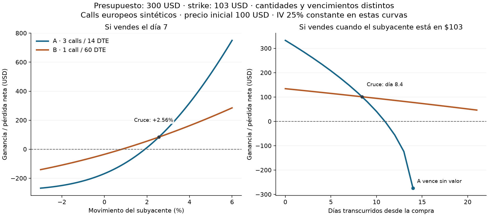

# ¿Tres calls baratos o un call más caro con 300 USD?

**4 de noviembre de 2026 · Ejemplo sintético, sin gasto en datos.** La comparación
A/B ya permite elegir dos series y fijar la cantidad exacta de cada compra.
Cada una parte del mismo presupuesto completo. No se suman las dos inversiones.

Con el ejemplo inicial —subyacente a 100 USD, objetivo de +3% en siete días—,
**tres calls de 14 días ganan 148.35 USD y un call de 60 días gana 106.93 USD**.
Pero si la subida solo llega al +1.5%, la compra corta pierde 44.86 USD y la
larga gana 31.36 USD. El plazo y el tamaño del movimiento cambian la respuesta.

## Las dos compras

Ambas tienen strike 103 y multiplicador 100. La prima de entrada se genera con
Black–Scholes europeo, IV de 25%, tasa anual de 4%, dividendo continuo de 1.3%
y semispread de 0.04 USD por unidad. Se presupuestan 0.65 USD por contrato
al abrir y al cerrar. El efectivo no genera intereses.

| Al comprar | A: 3 calls, 14 DTE | B: 1 call, 60 DTE |
|---|---:|---:|
| Prima por contrato | 90.12 | 298.01 |
| Desembolso inicial (prima y apertura) | 272.30 | 298.66 |
| Reserva para el cierre | 1.95 | 0.65 |
| Capital reservado / pérdida máxima bajo estos costos | 274.25 | 299.31 |
| Efectivo libre de los 300 USD | 25.75 | 0.69 |
| Precio del subyacente para recuperar costos el día 7 | **101.91** | **100.82** |

Los importes se calculan antes del redondeo. El equilibrio al día 7 supone IV de
salida de 25%; difiere del equilibrio al vencimiento porque aún hay valor
temporal. El call largo tiene mejor resultado en varios escenarios desfavorables
de esta muestra, pero compromete más capital y su pérdida máxima es mayor.

## Qué ocurre al salir

Ganancia/pérdida neta en USD con **la cantidad y la entrada originales**.
El capital final es 300 USD más la cifra de la tabla.

| Escenario de salida | A: 3 × 14 DTE | B: 1 × 60 DTE | Mayor capital final, incluido efectivo |
|---|---:|---:|---|
| +3%, día 7 | +148.35 | +106.93 | A |
| +1.5%, día 7 | −44.86 | +31.36 | B |
| Sin movimiento, día 7 | −168.05 | −34.99 | Efectivo |
| −3%, día 7 | −268.12 | −140.50 | Efectivo |
| +3%, día 7, IV baja de 25% a 20% | +63.05 | +29.10 | A |
| +3%, día 14, IV 25% | −274.25 | +77.77 | B |
| +1.5%, día 14, IV 20% | −274.25 | −68.50 | Efectivo |

En el día 14, a 103 USD, A vence justo en su strike y paga cero; B conserva
46 días. Si la salida se pide **después** de que una serie venza, no se puede
valorar esa compra solo con el precio posterior. Se muestra el motivo y no
se declara un ganador conjunto en esa fila.



La izquierda mantiene la salida en el día 7 y cambia el movimiento. Entre
+1.5% y +3% se igualan cerca de **+2.56%**. La derecha fija el precio de salida
en 103 USD y varía el día: se igualan cerca del **día 8.42**. Son cruces entre
las dos ganancias bajo estos supuestos, no los puntos de equilibrio individuales.
Las curvas no representan una trayectoria estimada ni una probabilidad de llegar
al objetivo.

## Usar y reproducir

Desde la raíz del proyecto:

```powershell
python scripts/simulador_opciones.py
```

Abrir [la comparación local](http://127.0.0.1:8791/#duelo). El ranking inicial
sigue usando la máxima cantidad financiable por serie. En la sección A/B se
puede gastar menos: se seleccionan las series, se escriben las cantidades y se
pulsa **Comparar estas compras**. Las cantidades que exceden el presupuesto,
el límite de riesgo o el tope de contratos se rechazan en lugar de reducirse en
silencio. La descarga A/B guarda parámetros, cantidades, equilibrio, ganancia
neta y capital final por escenario.

La app no requiere cotizaciones, claves ni conexión al mercado. Los costos
y precios de salida son supuestos; no son fills. No hay ejercicio anticipado
ni dividendos discretos. Por ello este ejemplo no identifica el mejor contrato
real de una acción o ETF ni asigna una probabilidad de ganar.

Pasaron **78 pruebas focalizadas**, incluidas 13 del A/B. Se contrastaron los
precios con una implementación independiente de la fórmula europea, las dos
comisiones, cantidades, efectivo, equilibrio, vencimiento, rechazos y endpoint
local. La prueba de Edge comprobó el ejemplo, los cambios de serie y cantidad,
la descarga, el estado sin resultados y el diseño en pantallas de 320/375 px.

```powershell
python experiments/duelo_20261104/demo.py
python -m pytest tests/test_duelo.py tests/test_simulador.py tests/test_escenarios.py tests/test_posiciones.py tests/test_comparador_pdf.py -q -p no:cacheprovider
```

[Ejemplo reproducible en JSON](../experiments/duelo_20261104/resultados/comparacion.json) ·
[Guía de la app](../apps/simulador/README.md). El siguiente paso hacia contratos
observados es admitir una cadena local con precios, tamaños, timestamp y estilo
de ejercicio, y devolver «sin comparación» si el modelo o la calidad no sirven.
