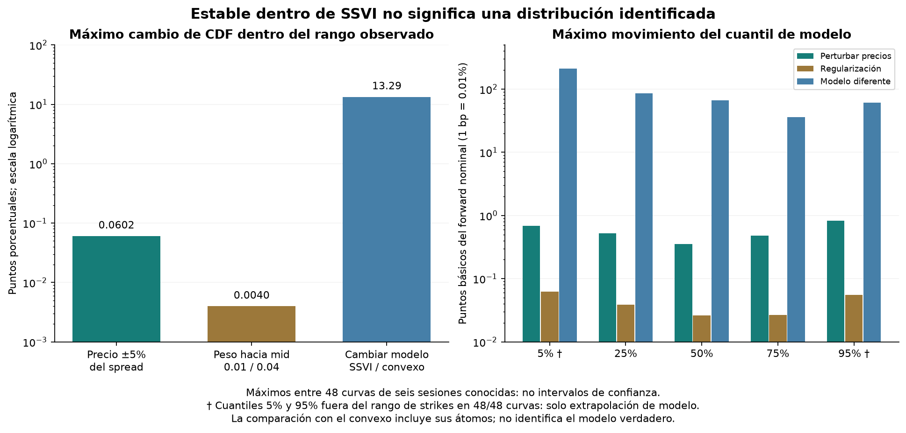

# QuantileFlow: una superficie estable puede dar probabilidades dependientes del modelo

Fecha: 14 de octubre de 2026. Presupuesto de datos **US$0**.

SSVI cambia poco ante los pequeños shocks probados. Pero otra representación de los
mismos precios, la distribución convexa, asigna probabilidades acumuladas bastante
distintas. **Estabilidad dentro de una familia no identifica la distribución verdadera.**
Todavía no conviene traducir estas probabilidades en confianza para gestionar posiciones.

## Resultados

| Cambio aplicado | Máxima diferencia de CDF en rango de strikes | Máximo movimiento de mediana Q |
|---|---:|---:|
| Trasladar precios de training hasta 5% del spread | **0.06024 puntos porcentuales** | **0.35525 bp = 0.0035525% de F nominal** |
| Peso hacia mid de 0.02 a 0.01 / 0.04 | **0.00397 puntos porcentuales** | **0.02635 bp = 0.0002635% de F nominal** |
| SSVI nominal frente a convexo nominal | **13.29007 puntos porcentuales** | **66.54107 bp = 0.665411% de F nominal** |

Son máximos entre **48 curvas de doce fotos de seis sesiones conocidas**, no intervalos
de confianza ni resultados de 48 días independientes. Los máximos de cada columna
pueden ocurrir en distintas curvas. Un punto porcentual de CDF y un punto básico de
precio son unidades diferentes: las columnas no se comparan numéricamente entre sí.

Por ejemplo, la mediana terminal Q apenas se mueve con estos pequeños shocks de entrada,
pero puede diferir mucho más al cambiar la familia de distribución. Eso no anticipa
un movimiento del stock: caracteriza la dependencia del resultado de nuestros supuestos.

## Cómo hicimos la prueba

Mismas fotos del 2, 5, 6, 7, 8 y 9 octubre, 09:45/10:00 ET; mismo universo y split
del ensayo anterior. No se refiltraron strikes al cambiar F. Los precios reservados
no se perturbaron ni se usaron para elegir ajustes, inicializaciones o amplitud.

El semispread es `(ask-bid)/2`. Trasladamos **bid y ask juntos**, preservando ancho,
por hasta `0.1*semispread`, que equivale al 5% del spread completo. En bids muy bajos
se limita la magnitud a `0.1*min(semispread,bid)` para preservar positividad.
Es una traslación hipotética de la cotización, no ensanchar bandas para que el modelo apruebe.

Seis shocks prefijados: paralelo arriba/abajo; calls arriba y puts abajo/inverso;
y dos jitters deterministas con semillas 17/29, independientes del orden de filas.
En cada shock se reestima F solo con pares de training y se ajusta SSVI con tres
inicios fijos, seleccionando exclusivamente por costo de entrenamiento.

También duplicamos/dividimos por dos el peso hacia midpoint, **con F congelado**,
para separar regularización de ruido de precios. Se reutiliza el ajuste nominal
anterior: vuelve a reproducir **744/1,642** precios reservados dentro de banda.
Hay 72 ajustes perturbados por precios y 24 por regularización; con los doce nominales
se evalúan 108 superficies, cada una con cuatro vencimientos.

Estos shocks no recorren todas las cotizaciones posibles dentro de las bandas, ni
errores grandes del feed, regímenes nuevos o otra referencia independiente. Son un
control local determinista, **no una estimación estadística de incertidumbre**.

## Un eje común para no confundir forma y forward

Comparamos `CDF(S_T/F_nominal)` entre versiones, manteniendo el mismo precio terminal
en el eje horizontal. Si una versión mueve F, evaluamos su CDF en
`log[(S_T/F_nominal)/(F_version/F_nominal)]`.

También registramos cambios de forma a moneyness fija por separado. No confundimos
un pequeño movimiento de F con un descubrimiento direccional. El máximo cambio de F
en los shocks de precio fue **0.24828 bp = 0.002483%**.

La CDF principal se compara entre mínimo y máximo strike de training por vencimiento.
Registramos además una malla más amplia de 0.85–1.15 en `S_T/F_nominal`, marcada como
diagnóstico de modelo porque incluye extrapolación. Tener strikes en un intervalo no
garantiza identificación estadística de todas las probabilidades dentro de él.

La fórmula y las restricciones SSVI proceden de [Gatheral y Jacquier](https://arxiv.org/abs/1204.0646).
No modificamos la familia, las restricciones o el contrato de cuantiles identificados.

## Qué cuantiles respaldan los strikes de esta muestra

| Nivel de cuantil nominal SSVI | Dentro del rango de strikes de training |
|---|---:|
| 5% | **0/48** |
| 25% | 48/48 |
| 50% | 48/48 |
| 75% | 46/48 |
| 95% | **0/48** |

Esto es cobertura geométrica del intervalo, no un certificado de identificación ni
elegibilidad operativa. Las fotos siguen siendo indicative y bloqueadas para uso puntual.
El 5%/95% requiere extrapolar todas las curvas; dos cuantiles 75% también quedan fuera.

Calculamos los cuantiles completos **solo para diagnosticar cuánto depende la
extrapolación del modelo**. Se guardan en campos distintos; no rellenan los cuantiles
no identificados del contrato. La máxima diferencia del cuantil 5% entre modelos es
**211.32 bp = 2.1132% de F nominal**, pero no es una cola de riesgo validada con los datos.

## Por qué importa comparar con la distribución convexa

El convexo nominal respeta masa/media y calendario normalizado, y ajusta más precios
reservados que SSVI (47.38% frente a 45.31%). Lo usamos como contraste de forma, sin
reentrenarlo en cada perturbación. No volvemos a usar la red rechazada por PDF negativa.

Para medir la diferencia de CDF con una distribución discreta no basta una malla
uniforme: podría saltarse un átomo. Evaluamos **antes y después de cada átomo** y los
extremos del intervalo. Como la CDF continua es monótona y la discreta es constante
entre átomos, esos puntos cubren el supremo de la diferencia en el intervalo.

Los 13.29 puntos de discrepancia incluyen los átomos y las decisiones de soporte/
regularización del convexo. No demuestran que esa distribución sea correcta ni que
SSVI esté equivocada en esa magnitud. Ambos ajustes son imperfectos en este feed.
La conclusión es más limitada: precios con desempeños de ajuste comparables pueden
producir distribuciones muy distintas con nuestras construcciones actuales.

La figura de ejemplo, local y fuera de Git, muestra la primera foto cronológica:
las perturbaciones de SSVI apenas separan las CDF, mientras el convexo tiene saltos
visibles. Esos saltos no son concentraciones físicas de precio descubiertas en el mercado.

## Verificación y decisión

Pasaron **380 pruebas**, seis nuevas. Cubren conservación de spreads/holdout, positividad,
jitter invariante al orden, cuantiles frente a una lognormal conocida, desplazamiento
mecánico de F, inversa generalizada discreta y detección de saltos que una malla perdería.

El verificador independiente comprueba **2,160 cuantiles** (`CDF(q)=alpha`), reproduce
**14,778 precios reservados** y todos sus conteos, y recalcula los movimientos de CDF y
la distancia entre modelos. Los errores son compatibles con precisión numérica:
3.33e-12 en CDF al evaluar cuantiles y 1.12e-14 puntos porcentuales en su desplazamiento.
Huellas de código y salidas privadas quedan registradas. No se publican precios por contrato,
parámetros, forward ni cuantiles absolutos.

Conservamos SSVI como referencia matemática estable bajo los shocks probados. **No
promovemos su PDF a confianza predictiva ni a regla de posición.** No cambiamos
recopilación, normalización, workflows, feed, ni presupuesto; no se enviaron órdenes.

Siguiente paso: comprobar si el crudo existente permite ampliar la ventana de strikes
con calidad suficiente, antes de recopilar o comprar más. Congelar la nueva comparación
y repetirla en días posteriores. Después podremos construir intervalos de ambigüedad
de distribución o contrastes más suaves; no llamarlos intervalos estadísticos sin una
metodología que lo justifique. La captura de más DTE/frecuencia sigue necesitando su
prueba operativa independiente.
