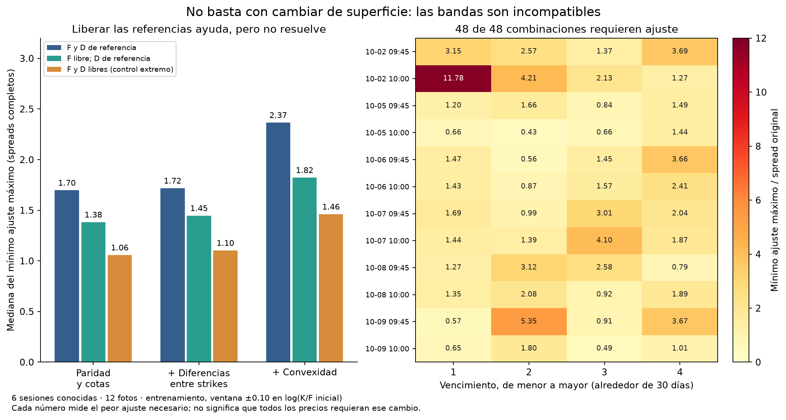

# QuantileFlow: avanzamos hasta un problema que requiere decidir

Fecha: 20 de octubre de 2026, Nueva York. Gasto en datos: **USD 0**.

**Resultado:** el problema de ajuste no se resuelve únicamente cambiando SSVI,
el forward o el descuento. En las 48 combinaciones de foto y vencimiento del
estudio, las bandas seleccionadas son incompatibles entre sí bajo restricciones
necesarias de precios europeos. Esto ocurre aun dejando libres tanto el forward
como un descuento no negativo sin límite superior. Antes de convertir estas
cotizaciones en una PDF y en “confianza” de una posición, debemos elegir cómo
representar el error de observación o conseguir una muestra independiente.

## Qué se avanzó

- Correcciones separadas de la rama de estrategias: mínimo KL para media de
  precio, compensación de cola, rechazo de probabilidades negativas y explicación
  del criterio de puts. **46 pruebas pasadas** y cinco ejemplos sintéticos
  regenerados. Se documentó que el ajuste adicional de varianza logarítmica
  sigue siendo una familia paramétrica, sin garantía de mínimo KL.
- Nuevo diagnóstico en espacio de precios: **2,304 problemas lineales resueltos**,
  con comprobación primal/dual y otro verificador que reconstruye los precios
  y sus restricciones a partir de las soluciones guardadas.
- Conservación del snapshot, las reservas y los experimentos anteriores.
  No se desplegó mantenimiento ni se modificó el capturador.

## Pregunta y diseño

La pregunta es más básica que “¿qué superficie ajusta mejor?”:

**¿Existe siquiera un conjunto de precios que quede dentro de todos los bid/ask
y respete las relaciones europeas comprobadas?**

Se comprobaron restricciones anidadas:

1. Paridad call/put, no negatividad y cotas de precios.
2. Monotonía y cotas de diferencias entre strikes.
3. Convexidad en strike.

No se impuso SSVI, una red, una PDF paramétrica ni una malla de probabilidad
terminal. Tampoco se impuso calendario entre vencimientos. Una infactibilidad
bajo este conjunto más débil descarta cualquier superficie que deba cumplirlo.
Una factibilidad finita, en cambio, no certificaría la extensión global ni
identificaría una distribución.

La formulación de reparación por programación lineal tiene antecedentes en
[Cohen, Reisinger y Wang](https://arxiv.org/abs/2008.09454).
Aquí se usa como diagnóstico: no se sustituyen los precios originales por los
reparados. Se resolvió con HiGHS mediante
[`scipy.optimize.linprog`](https://docs.scipy.org/doc/scipy/reference/optimize.linprog-highs.html),
SciPy 1.17.1 instalado.

**Muestra:** seis sesiones conocidas del 2 al 9 de octubre, doce fotos y cuatro
vencimientos por foto, próximos a 30 días: 48 combinaciones, no 48 días.
Se analizaron ventanas ±0.03 y ±0.10 de log-moneyness original, separando training
y holdout. En la ventana amplia son 5,912 filas de training y 3,047 reservadas.
Se conservaron los filtros originales; las 714 exclusiones del ensayo amplio
por IV no finita no se reincorporaron. Las nuevas sesiones del 12 al 20 aún no
forman parte de este experimento.

## Cuánto hay que mover los precios

Para cada cotización se define spread = ask − bid. Se permite ampliar la banda:

```text
[bid − rho*spread, ask + rho*spread]
```

El primer objetivo minimiza el máximo ajuste permitido, rho. Se reporta en
spreads completos por lado. No significa que todas las cotizaciones deban
moverse esa cantidad: alguna restricción obliga a que al menos una alcance
ese máximo mínimo.

**Training amplio, con todas las restricciones hasta convexidad:**

| Referencias permitidas | Combinaciones factibles sin ampliar | Mediana del mínimo ajuste máximo | Mayor ajuste máximo |
|---|---:|---:|---:|
| F y D del experimento previo | 0/48 | 2.37 spreads | 17.43 spreads |
| F libre, D previo | 0/48 | 1.82 spreads | 11.78 spreads |
| F y D libres | **0/48** | **1.46 spreads** | **11.78 spreads** |

El último caso permite incluso descuentos económicamente inverosímiles y D=0
como relajación matemática. No es una estimación de tasas ni una nueva
referencia recomendada. Aun así, ninguna de las 48 combinaciones encaja.
La paridad y las cotas por sí solas ya fallan en 48/48 con F y D libres;
la convexidad aumenta el ajuste necesario.

En holdout amplio, considerado **por separado y a posteriori**, también fallan
48/48: con F y D libres la mediana del mínimo máximo es 0.71 spreads y el peor
caso 3.41. No es un resultado predictivo ni calibración fuera de muestra.



Un segundo objetivo minimiza la **media de ajustes individuales**, no el
máximo. Con F/D libres, en training amplio el promedio ponderado es 0.194 spreads
por cotización, o 0.289 unidades de cotización. Esto importa: un peor caso grande
no demuestra que todo el conjunto sea inútil. Son óptimos de criterios distintos;
el ajuste medio tampoco identifica cuáles precios están “mal” ni minimiza su
número. Puede haber varias reparaciones óptimas.

## Qué demuestra y qué sigue sin demostrar

**Sí:** con estas entradas, perseguir un ajuste perfecto dentro de bid/ask es
un objetivo imposible bajo las restricciones verificadas. Añadir una red mayor
o más parámetros no elimina esa contradicción. La incertidumbre de los precios
debe entrar explícitamente en el problema.

**No:** no prueba que todo venga del proveedor, que haya arbitraje ejecutable,
ni que toda PDF sea inútil. Modificación de precios, falta de sincronización,
referencias, metadatos o filtros pueden contribuir. Hay que contrastarlos.
El LP tampoco demuestra que nuestra superficie actual sea la mejor aproximación:
su error puede seguir excediendo mucho lo inevitable.

No demuestra rentabilidad, probabilidad física de subir, precios futuros de
salida ni estabilidad del ranking del comparador. No convierte el mayor volumen
de capturas en validación estadística. Son seis sesiones ya exploradas.

## La decisión que dejo preparada

| Camino | Trabajo concreto siguiente | Qué entrega | Costo / límite |
|---|---|---|---|
| **A. Priorizar el simulador condicional** | Comparar strike, DTE y cantidad con presupuesto; estresar spot, plazo, IV y costos; mostrar cuándo cambia el ganador | Herramienta útil para expresar “si ocurre X en N días” | USD 0; no entrega una probabilidad validada de ganar |
| **B. Priorizar las distribuciones bajo datos ruidosos** | Definir un modelo de error de observación, investigar filtros causales y construir varias curvas admisibles; contrastar F/D fijos y supuestos económicos | Rangos de CDF/valoración y diagnóstico de qué decisiones son robustas a la reparación | USD 0; más investigación y posibilidad de concluir que las bandas son demasiado amplias |
| **C. Contrastar primero una muestra real accesible** | Buscar una exportación autorizada de bid/ask reales y sincronizados, con los mismos contratos/horas | Evidencia de cuánto del conflicto viene de medición | Solo si se obtiene sin gasto; una muestra no valida rentabilidad |

**Recomiendo priorizar A**, que coincide con la idea del contrato bajo un
presupuesto, manteniendo B como investigación separada. Si la prioridad es
precisamente la PDF y su transporte, elegir B: las tolerancias de ruido no deben
ajustarse hasta que aparezca una señal atractiva. C es un contraste útil cuando
exista una muestra accesible, no una compra autorizada.

No escogí ni apliqué una regla de limpieza, descarte o ampliación a producción:
esa elección cambia las probabilidades y puede cambiar el contrato elegido.
Tampoco conecté las reparaciones de este experimento al comparador ni inventé
confianza. Ese es el límite donde se necesita decidir el siguiente objetivo.

## Verificación y archivos

- **13 pruebas del diagnóstico:** precios coherentes, ejemplos de solución
  analítica, contradicción de paridad, convexidad, cambio de unidades, orden,
  referencias libres y entradas inválidas.
- **2,304 soluciones comprobadas:** máximo residual primal 4.62e−13 y máxima
  brecha primal/dual 1.71e−11 en sus unidades normalizadas.
- Verificador independiente: máximo error de reconstrucción **1.06e−10**;
  reproduce costos de reparación y restricciones, y comprueba todos los hashes.
- Se inspeccionó la figura. Las cotizaciones individuales, anclas F/D y
  soluciones por contrato permanecen en la carpeta privada externa.

Entradas, método y agregados:
[`experiments/factibilidad_20261020/`](../experiments/factibilidad_20261020/).
Correcciones de estrategias:
[rama separada](https://github.com/hectorcs23/QuantileFlow/tree/codex/correcciones-entropia-20261020).

El mantenimiento operativo sigue pendiente. No se atribuye a esta ejecución un
cambio de imagen de GitHub, del disparador ni del código fijado de captura.
