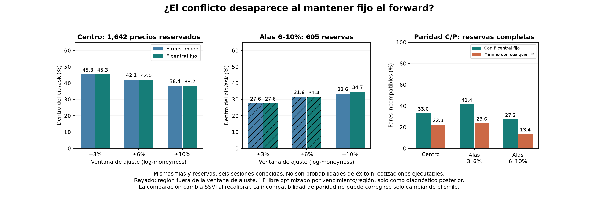

# QuantileFlow: fijar el forward no resuelve el compromiso entre centro y alas

14 de octubre de 2026. Presupuesto de datos **US$0**. Mismas seis sesiones conocidas,
doce fotos y cuatro vencimientos por foto, alrededor de 30 días. No hay cotizaciones
nuevas, etiquetas futuras ni una prueba predictiva independiente.

Repetimos el ajuste de ±6%/±10% manteniendo fijo el forward estimado exclusivamente
con los pares de training de la ventana central. El deterioro central permanece.
Este control sugiere que **el cambio de forward no es el principal responsable del
compromiso observado**, dentro de nuestra construcción y muestra. No demuestra si
el resto viene de rigidez de SSVI, la pérdida, las cotizaciones o una combinación.

## Resultado sobre las mismas reservas

| Ventana de ajuste | F reestimado: centro | F central fijo: centro | F reestimado: alas 6–10% | F central fijo: alas 6–10% |
|---|---:|---:|---:|---:|
| ±3% | 744 / **45.31%** | 744 / **45.31%** | 167 / 27.60% (*) | 167 / 27.60% (*) |
| ±6% | 692 / 42.14% | 689 / **41.96%** | 191 / 31.57% (*) | 190 / 31.40% (*) |
| ±10% | 630 / 38.37% | 628 / **38.25%** | 203 / 33.55% | 210 / **34.71%** |

Centro: **1,642** cotizaciones reservadas; alas lejanas: **605**. (*) Región fuera
de la ventana de ajuste: extrapolación diagnóstica. Ventanas de log-moneyness,
aproximadamente porcentajes. No cambiar denominadores al comparar versiones.

Congelar F cambia el porcentaje central frente a reestimarlo solo **−0.18 pp** en
±6% y **−0.12 pp** en ±10%. En cambio, ampliar training de ±3% a ±10% con F fijo
reduce el porcentaje central **7.06 pp**, a la vez que mejora las alas lejanas.
Los conteos de aciertos tienen umbrales en el bid/ask; no son una descomposición
lineal de costos, una estimación causal universal ni probabilidades de éxito.

En las **3,047 reservas** del universo amplio, incluyendo el centro y ambas alas,
los aciertos son 1,211/39.74% (±3%), 1,209/39.68% (±6% con F fijo) y
1,155/37.91% (±10% con F fijo). Esta comparación sobre el mismo universo incluye
extrapolación para las ventanas menores. No avala elegir una ventana para operar.

## Un límite que ninguna forma de smile puede eliminar

Para calls y puts europeos con el mismo strike, plazo, forward y descuento:

`C − P = D × (F − K)`.

Las cotizaciones acotan `C − P` entre `bid_call − ask_put` y
`ask_call − bid_put`. Cada par completo define una banda de forwards compatible.
Si F queda fuera, **al menos uno de los dos precios del modelo debe quedar fuera
de su bid/ask**, con independencia de SSVI o de la forma de distribución elegida.
Es una incompatibilidad del modelo europeo con estas cotizaciones, no una
oportunidad de arbitraje ejecutable en un feed indicative.

| Región de reservas | Pares completos | Incompatibles con F central | Mínimo con cualquier F por vencimiento/región |
|---|---:|---:|---:|
| Centro | 821 | 271 / 33.01% | **183 / 22.29%** |
| Alas 3–6% | 343 | 142 / 41.40% | **81 / 23.62%** |
| Alas 6–10% | 224 | 61 / 27.23% | **30 / 13.39%** |
| Universo amplio, un F común por vencimiento | **1,388** | 474 / 34.15% | **374 / 26.95%** |

Los mínimos por región permiten distintos F en cada región: son límites optimistas
y **no se suman para obtener un único forward global**. El mínimo conjunto se calcula
aparte con todas las bandas de cada vencimiento. Por eso 183+81+30=294 no equivale a
los 374 del conjunto. El descuento sigue fijo; no se ha optimizado la tasa.

El mínimo se obtiene contando el mayor número de intervalos que pueden solaparse.
Es diagnóstico posterior que usa cotizaciones reservadas para establecer un límite;
**no se utiliza para calibrar, seleccionar modelos ni reemplazar el forward training**.

Los porcentajes son de **pares**, no de precios individuales. El límite conjunto
implica al menos 374 precios individuales fuera de las 3,047 reservas, pero deja
mucho margen sobre nuestros actuales aciertos: **no explica por sí solo todo el
mal ajuste ni exonera al modelo**. Los 271 precios sin contraparte elegible
no entran en el conteo de pares completos.

En la partición training amplia, el mínimo conjunto es **715/2,704 pares (26.44%)**.
La incompatibilidad también existe sin consultar el holdout. Para ventanas menores,
la partición training contiene filas de las alas que no se usan para calibrar;
los diagnósticos se presentan sobre el universo amplio congelado para ser comparables.

## Método y verificación

- Se verifican las huellas de las entradas privadas del ensayo de ventanas y sus
  fuentes. Los datos, filtros, split anidado, descuento, peso 0.02 y tres inicios
  SSVI prefijados permanecen iguales. Solo se cambia el ancla de F en el contraste.
- ±3% reutiliza la superficie original; ±6%/±10% se recalibran con el F central
  por vencimiento. Las variantes con F reestimado se leen del ensayo previo.
- Solo se aceptan ajustes convergentes, finitos y con las restricciones SSVI.
  Se controlan adicionalmente densidad no negativa y calendario en mallas. Hubo
  avisos de overflow en exploraciones descartadas del optimizador; no se modificó
  el núcleo histórico para ocultarlos ni se aceptaron soluciones inválidas.
- Pasan **cuatro pruebas nuevas** de bandas, descuento, extremos cerrados, mínimos,
  pares incompletos, invariancia al orden y rechazo de datos inconsistentes.
- El verificador usa fórmulas de precios independientes y un barrido de extremos
  de intervalos para recalcular la paridad. Comprueba que las entradas y reservas
  están intactas, que todos los forwards fijos coinciden con la versión central y
  que cada par incompatible obliga a un precio fuera de banda en los modelos usados.
  Reproduce **53,754 precios**, con error máximo **3.64e-12**, y verifica **144 anclas**
  congeladas. Los modelos nuevos guardan solo T/F/D de las anclas originales; no
  heredan sus cuantiles, que corresponderían a una superficie diferente.
  Los conteos se revisan repetidamente entre versiones y regiones: no son nuevas
  observaciones independientes. La evidencia exacta está en `verificacion.json`.

## Decisión y siguiente contraste

**No promover la superficie amplia a una regla de posición.** Fijar F no consigue
la mejora uniforme que buscábamos. Se conserva el nominal como referencia histórica,
y las variantes amplias quedan disponibles para diagnóstico.

El siguiente paso es comparar con una representación convexa sobre **el mismo
universo amplio, mismas reservas y mismo forward fijo**, para separar flexibilidad
de forma de la referencia. La paridad será un límite común a ambos modelos. Si el
convexo tampoco mejora suficientemente, será válido cerrar este enfoque de ajuste
puntual con el feed actual y conservar únicamente métricas descriptivas robustas.

No se modificaron recopilación, workflows, configuraciones, etiquetas, reglas de
posición ni presupuesto. Todas las fotos conservan su bloqueo operativo.
Los parámetros, forwards y precios individuales siguen fuera del repositorio público.
