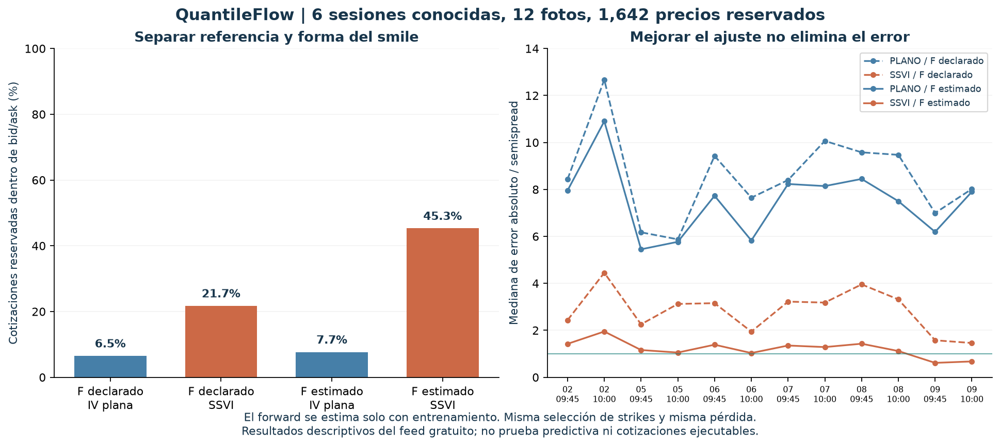
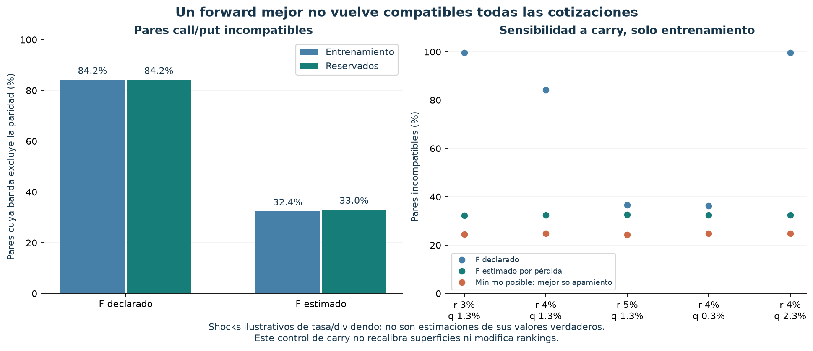

# QuantileFlow: cómo construimos las superficies y qué cambió al estimar el forward

Fecha: 14 de octubre de 2026. Presupuesto de datos: **US$0**.

**El forward y el skew importan juntos.** Estimar una referencia por vencimiento con
entrenamiento eleva la cobertura SSVI de 21.74% a 45.31% en los mismos precios reservados.
Todavía no basta para recomendar contratos: 898 de 1,642 quedan fuera de banda y
los doce cortes conservan sus bloqueos para uso puntual.

## La comparación que ejecutamos

| Referencia y forma | Dentro de bid/ask, reservado | Mediana de error por corte / semispread |
|---|---:|---:|
| F declarado, IV plana | 107/1,642 = 6.52% | 5.87–12.67 |
| F declarado, SSVI | 357/1,642 = 21.74% | 1.46–4.45 |
| F estimado, IV plana | 126/1,642 = 7.67% | 5.45–10.90 |
| F estimado, SSVI | 744/1,642 = 45.31% | 0.615–1.950 |

Con SSVI, cambiar F suma 23.57 puntos porcentuales de cobertura; con IV plana suma 1.16.
Con F estimado, introducir skew suma 37.64 puntos. Son contrastes condicionados al modelo,
con interacción: no existe una descomposición causal única que asigne toda la mejora a un solo factor.
SSVI con F estimado mejora el conteo y la mediana de error en las doce fotos.

Son seis sesiones conocidas, 2, 5, 6, 7, 8 y 9 de octubre, con dos fotos por sesión.
Se conservaron 3,176 filas de entrenamiento y 1,642 reservadas. Cada tercer strike queda
reservado con su call y put juntos. Se mantuvieron los mismos filtros, descuentos y pérdida
del experimento anterior. No se usa holdout para estimar F, elegir inicializaciones o refiltrar.
Las referencias iniciales provienen del mismo feed y carry provisional; no son un spot independiente.

## Cómo construimos la superficie, paso a paso

1. **Una foto limpia por corte.** Usamos cotizaciones disponibles y filtros declarados.
   Separar entrenamiento y reserva antes de ajustar evita aprender sus precios directamente.
2. **Una ancla por vencimiento.** Para cada par europeo del mismo strike, `C-P=D(F-K)`.
   Su bid/ask produce `F ∈ [K+(bidC-askP)/D, K+(askC-bidP)/D]`.
   Estimamos un F común solo con esos intervalos de entrenamiento; el descuento sigue fijado.
3. **Una curva por vencimiento.** La abscisa es `k=log(K/F)` y la variable ajustada es
   varianza implícita total `w=IV²*T`, no una PDF suavizada a mano.
4. **Una familia que conecta las curvas.** SSVI usa
   `w(k,T)=theta(T)/2 * [1+rho*phi(theta)*k+sqrt((phi(theta)*k+rho)^2+1-rho^2)]`.
   Hay cuatro valores ATM `theta(T)` y tres parámetros comunes: `rho`, `eta`, `gamma`,
   con `phi(theta)=eta/[theta^gamma*(1+theta)^(1-gamma)]`.
   Theta marca nivel/estructura temporal; rho y phi controlan pendiente y curvatura conjuntamente.
5. **Ajustar precios, respetando spreads.** Convertimos cada curva a primas Black.
   Minimizamos distancia a `[bid,ask]` dividida por semispread, más un peso 0.02 hacia mid.
   Este término regulariza también fuera de banda; no es solo un desempate ni obliga a satisfacerlas.
6. **Restringir la forma.** Incrementos positivos de theta, `|rho|<1`, `0<gamma<1/2`
   y `eta*(1+|rho|)<2` imponen las condiciones suficientes de la familia usada.
   Hay tres inicializaciones fijas, seleccionadas solo por costo de entrenamiento.
7. **Construir distribución y evaluar.** La curvatura del call cumple `C_KK=D*p_Q(K)`.
   Con derivadas analíticas de SSVI obtenemos PDF y CDF. Comparamos precios reservados
   y no interpretamos Q como probabilidad física de que una operación gane.

Las restricciones siguen [Gatheral y Jacquier](https://arxiv.org/abs/1204.0646).
Son condiciones para arbitraje estático del modelo; no certifican que el feed sea ejecutable.
Los controles de calendario se aplican a la familia en coordenadas normalizadas por F;
estimar F por separado no certifica su coherencia con una curva de carry externa.
Interpolamos theta linealmente entre vencimientos. Antes del primero y después del último
se usa una extrapolación explícita: su apariencia suave no es evidencia de mercado.

La figura local `construccion_superficie.png`, guardada fuera del repo, muestra la primera
foto cronológica, no la de mejor resultado: cotizaciones y curvas, superficie 3D, cobertura
real frente a extrapolación, y PDF Q. Contiene información por contrato y no se publica en Git.
El dominio observado sigue siendo estrecho: alrededor de ±3% de log-moneyness y
vencimientos de aproximadamente 27–33 días. No tenemos cobertura equivalente a 7/14/60/90 DTE.

## La referencia importa, pero no explica todo

La pérdida de F es `sum[(F-clip(F,l,u))²/h² + 0.02*(F-mid)²/h²]`, con h semiancho del
intervalo de cada par. Su derivada es estrictamente creciente; se resuelve por bisección.
Esto usa **los precios de entrenamiento**, no un F observado externamente ni un pronóstico físico.
Cada F es una variable adicional por vencimiento, compartida por los dos modelos del contraste.

| Pares call-put incompatibles | F declarado | F estimado |
|---|---:|---:|
| Entrenamiento | 1,337/1,588 = 84.19% | 514/1,588 = 32.37% |
| Reservados | 691/821 = 84.17% | 271/821 = 33.01% |

El desplazamiento mediano de F es **+0.0704%**, con rango +0.0257% a +0.1109% en las
48 combinaciones foto/vencimiento. Un desplazamiento pequeño puede contradecir muchas bandas estrechas.
No es una señal de que el stock vaya a subir 0.07%: estamos reestimando una ancla de valoración actual.

La sensibilidad cambia r entre 3/4/5% y q entre 0.3/1.3/2.3%, uno por vez.
Son perturbaciones ilustrativas, no estimaciones actuales de tasas/dividendos.
La referencia declarada produce entre 575 y 1,583 pares incompatibles; al reestimar F,
entre 513 y 517. El mínimo teórico posible, por solapamiento, sigue entre 387 y 394.
Aquí **no se recalibraron superficies bajo cada shock**: es un diagnóstico de paridad.
F estimado absorbe q a descuento fijo; estas opciones por sí solas no separan un error de
q de un error de spot inicial. No podemos identificar la causa sin otra referencia.

El óptimo cuadrático por banda no maximiza el número de bandas compatibles.
Con r=4%, el control anterior permite como mínimo 394 incompatibles; el estimador adoptado deja 514.
No seleccionamos otra pérdida después de mirar cuál mejora holdout.

Con el F estimado y D adoptado, los 271 pares incompatibles reservados obligan a dejar
al menos 271 opciones fuera: incluso una forma perfecta tendría una cobertura **a lo sumo
83.50%** en ese universo. Esta es una cota necesaria, no una cobertura alcanzable garantizada;
convexidad y calendario pueden imponer obstáculos adicionales.

## Qué sí parece viable y qué no

- **IV plana como modelo principal de estas cadenas: no resulta adecuada.** Solo 7.67% en banda
  aun después de estimar F. La conservamos como referencia sencilla; no como solución final.
- **SSVI con F de entrenamiento: viable para investigación.** Mejora en los doce cortes,
  respeta las restricciones y representa mejor skew. Sigue dejando 54.69% fuera de banda.
- **Un modelo que cuadre exactamente con todos estos precios: incompatible con paridad**
  a descuento declarado, incluso permitiendo otro F común. Más flexibilidad o ML no elimina esa contradicción.
- **Selector operativo/predictor de dirección: todavía no viable con esta evidencia.**
  Indicative, sellos/referencia y ausencia de validación temporal siguen siendo bloqueos.
  No se computaron nuevos rankings ni cambió el código de captura.

Alpaca documenta que [indicative modifica las cotizaciones](https://docs.alpaca.markets/us/reference/optionlatestquotes).
Eso impide tratarlas como ofertas ejecutables, pero no autoriza atribuirle todo el error:
carry, referencia y forma del modelo también influyen.

## Comprobaciones y próximos pasos

Se revalidaron las huellas de las tablas, 32 manifiestos y 163 páginas crudas de este
snapshot. Un verificador independiente reprodujo **19,272 precios** con error máximo
**2.73e-12**, y comprobó los 48 mínimos convexos de F con otro optimizador, el split por
strike y la ausencia de cotizaciones/identificadores individuales en el JSON público.
Las condiciones SSVI se cumplieron; el mínimo adicional de g en malla fue 0.2558.
Ese barrido es un diagnóstico, no sustituye las restricciones analíticas.
La cuadratura adicional sobre las 48 rebanadas estimadas reprodujo masa y media
normalizada con errores máximos de 3.33e-16 y 4.70e-13; el call integrado desde PDF
coincidió con Black, con error máximo de 1.18e-13 al dividir el precio por F.
Son verificaciones de coherencia del modelo; no evidencias de que su PDF prediga retornos físicos.
Pasaron **368 pruebas**: 340 del núcleo/control de forward/método nuevo y 28 de los
experimentos previos de expiraciones, intradía y adaptador de cadenas. Las cinco pruebas
nuevas cubren recuperación de F, bandas incompatibles, independencia de holdout,
duplicados/entradas inválidas e invariancia de escala/orden.

1. Repetir las reglas congeladas en sesiones posteriores al 14 de octubre, sin excluir fallos.
   Días ya transcurridos 12–14 octubre no deben etiquetarse como evaluación prospectiva de esta regla.
2. Medir sensibilidad de parámetros/PDF a bandas y carry, conservando regiones de extrapolación.
3. Comparar una forma más flexible con restricciones, incluyendo un candidato ML, bajo el
   mismo F estimado y mismos splits. [Diseño del experimento ML](ML_SUPERFICIES_2026-10-14.md).
4. Después evaluar evolución real de la superficie y aporte a predicción; cinco días nuevos
   solo serán un control inicial de estabilidad, no entrenamiento suficiente de una red direccional.

Código y protocolo: `experiments/forward_superficies_20261014/`. Resultados individuales,
parámetros y figura de construcción quedan fuera del repositorio público.
