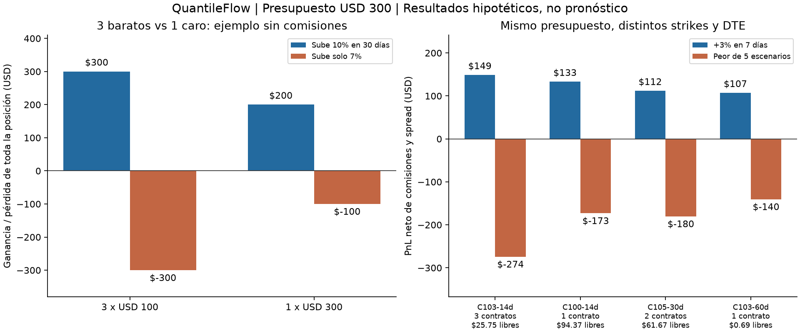

# QuantileFlow: elegir una posición con un presupuesto común

El comparador debe contestar: **«Con USD 300 y este movimiento en este plazo,
¿qué posición completa resulta más favorable?»** Por ejemplo, tres contratos
de USD 100 pueden superar a uno de USD 300, aunque cada contrato barato gane
menos. La cantidad también multiplica la pérdida y las sensibilidades.

## Qué incorporamos

El motor existente ya calculaba contratos enteros, comisiones y PnL total.
La nueva API `quantileflow.posiciones.comparar_posiciones` hace explícita la
comparación de posiciones: cantidad, costo por contrato, capital reservado,
efectivo libre, PnL por contrato y total, capital final incluyendo caja,
retorno sobre todo el presupuesto y sensibilidades monetarias totales.

El ranking principal usa **dólares netos de la posición en el escenario objetivo**.
Retorno sobre el capital utilizado y comportamiento adverso quedan separados.
La alternativa de mantener efectivo participa con PnL cero e interés cero.
La sensibilidad se multiplica por cantidad y multiplicador; los escenarios
se valoran completos, sin extrapolar una delta local a movimientos grandes.

Para presupuesto B, ask por unidad a, multiplicador M y comisión por contrato
y lado c, la cantidad máxima es:

```text
n = floor(min(B, límite de pérdida) / (a*M + 2*c))
n = min(n, límite de cantidad, si existe)
capital reservado = n*(a*M + 2*c)
efectivo libre = B - capital reservado
PnL total = n*((precio de salida asumido - a)*M - 2*c)
capital final = B + PnL total
```

Se conserva el multiplicador real. Una prima cotizada de 1.00 con multiplicador
100 cuesta USD 100 por contrato antes de comisiones. Antes del vencimiento,
la salida asumida es el precio del modelo menos el semispread, con piso cero.
Al vencer se usa el payoff, reservando conservadoramente comisión de cierre.

## Tu ejemplo: tres de USD 100 frente a uno de USD 300

Primero, ejemplo aritmético inventado, **sin comisiones**: spot inicial 100,
calls con 30 días hasta vencimiento, strikes 108 y 105 y primas totales de
100 y 300. Estas primas ilustran la contabilidad; no son cotizaciones ni una
calibración del modelo. Ambos escenarios terminan exactamente al vencer.

| Posición | Capital | PnL por contrato si S=110 | PnL total si S=110 | PnL total si S=107 |
|---|---:|---:|---:|---:|
| 3 calls K108 de USD 100 | 300 | +100 | **+300** | −300 |
| 1 call K105 de USD 300 | 300 | +200 | **+200** | −100 |

La primera gana más con la subida de 10%, pero pierde más si solo llega a 7%.
Comprar más contratos no significa tener una posición mejor en todos los casos.

Si la comisión es **USD 0.65 por contrato y lado**, con un límite estricto de
USD 300 caben **dos** contratos de prima USD 100: se reservan USD 202.60 y quedan
USD 97.40 libres. Uno de prima USD 300 necesita USD 301.30 y queda excluido.
El programa distingue prima, desembolso de entrada y reserva para cerrar.

## Ejemplo con movimiento antes del vencimiento

Capital ficticio USD 300; spot 100; objetivo **+3% en siete días**. Se comparan
12 calls europeos sintéticos con strikes 100/103/105/108 y DTE 14/30/60.
Primas Black–Scholes más 0.04 al comprar; IV 25%, tasa 4%, q 1.3%, comisión
0.65 por lado y salida del modelo menos 0.04. Se usa el motor PDE existente.

| Serie | Cantidad | Capital reservado | Efectivo libre | PnL objetivo aprox. | Peor PnL de los 5 escenarios aprox. |
|---|---:|---:|---:|---:|---:|
| Call K103, DTE 14 | 3 | 274.25 | 25.75 | **+149** | −274 |
| Call K100, DTE 14 | 1 | 205.63 | 94.37 | +133 | −173 |
| Call K105, DTE 30 | 2 | 238.33 | 61.67 | +112 | −180 |
| Call K103, DTE 60 | 1 | 299.31 | 0.69 | +107 | −140 |

En el objetivo, cada call K103 de 14 días gana aproximadamente USD 49.51;
tres suman USD 148.53. El K100 gana USD 132.89 por contrato, pero solo cabe uno.
Con el primero, el capital final sería aproximadamente USD 448.53. Su retorno
sobre los USD 300 es 49.5%, distinto del 54.2% sobre el capital reservado.

Los controles son: no subir, bajar 3%, subir 3% con caída de IV de cinco puntos,
y llegar a +3% en 14 días. En este último caso el call K103 vence sin valor:
**acertar el movimiento y fallar el tiempo puede perder toda la prima**.
Mantener efectivo gana el criterio de peor escenario en esta lista.



Estos resultados son condicionales y enteramente sintéticos. No estiman la
probabilidad de que el objetivo se cumpla ni demuestran una ventaja de trading.
El peor escenario de la lista tampoco es una cota general del riesgo.

## Uso y verificación

```python
from quantileflow.posiciones import comparar_posiciones

r = comparar_posiciones(
    contratos, spot, escenarios, presupuesto=300,
    escenario_objetivo="objetivo", limite_perdida=300,
    comision=.65, semispread_salida=.04,
)
print(r["posiciones"])
print(r["comparacion_presupuesto"])
```

Reproducir: `python experiments/presupuesto_20261016/demo.py`.
Resultados completos y hashes de las fuentes en `resultados/comparacion.json`.

Pasaron **32 pruebas** de posiciones, comparador y escenarios, incluidas siete
de esta incorporación. Comprueban 3 frente a 1, costos que cambian cantidades,
multiplicadores distintos de 100, límites de pérdida/cantidad, conservación de
caja, abstención y caja final antes del vencimiento. Pytest informó únicamente
que no pudo escribir su caché local de Windows; las pruebas terminaron bien.

La demo compara mallas 401/400 y 801/1200 nodos/pasos. Conservó los candidatos y
los tres rankings; el mayor cambio de PnL fue USD 4.24 entre todos los escenarios.
La tabla muestra la malla fina y redondea PnL: no garantiza precisión de centavos.

Cada candidato usa **una sola serie** y su cantidad máxima permitida. Esta
versión no combina series ni busca el tamaño óptimo para una utilidad o nivel
de confianza. El motor PDE sigue limitado a europeos con IV plana por contrato
y q continuo; una acción con opciones americanas requiere validar su motor y
dividendos correspondientes. El precio de salida y el tamaño ejecutable siguen
siendo supuestos; un límite de cantidad se puede proporcionar explícitamente.

El costo de datos de este ejemplo es USD 0. El presupuesto USD 300 representa
capital hipotético de la posición y es independiente del presupuesto de datos.
