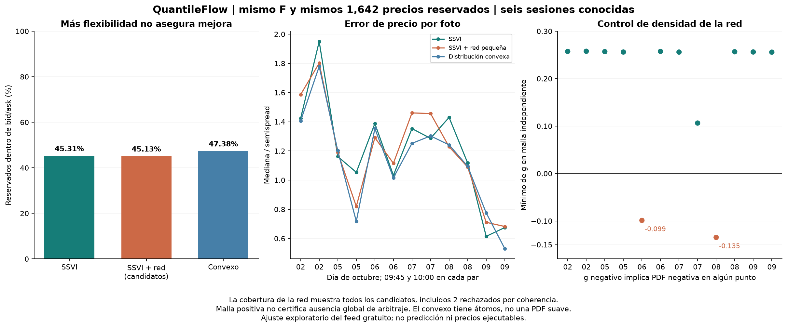

# QuantileFlow: probamos ML para la superficie y no adoptamos la primera red

Fecha: 14 de octubre de 2026. Presupuesto de datos **US$0**.

**La primera red pequeña no supera a SSVI y falla la coherencia en dos fotos.** Es un
resultado negativo útil: no conviene sustituir el modelo por algo más complejo solo
porque use machine learning. Una distribución convexa más flexible mejora modestamente
el ajuste, pero muestra cómo una buena representación de precios puede esconder
incertidumbre grande en la forma de la distribución.

## Lo que ejecutamos y el resultado

| Modelo | Entrenamiento dentro de banda | Reservados dentro de banda | Coherencia |
|---|---:|---:|---|
| SSVI con F de entrenamiento | 1,512/3,176 = 47.61% | 744/1,642 = **45.31%** | Condiciones suficientes de su familia |
| SSVI + red pequeña | 1,507/3,176 = 47.45% | 741/1,642 = **45.13%** | 2/12 candidatos fallan PDF; los restantes solo pasan malla/alas |
| Distribución convexa discreta | 1,642/3,176 = 51.70% | 778/1,642 = **47.38%** | Masa/media/positividad/calendario normalizado en 12/12, con tolerancias |

La cifra de la red incluye **todos los candidatos**, incluso los rechazados.
No se presenta como cobertura de un producto validado. La mejora del convexo es **34
cotizaciones, 2.07 puntos porcentuales**. No inferimos significancia estadística ni
rentabilidad de seis sesiones conocidas y precios de contratos correlacionados.

Son las mismas doce fotos de 2, 5, 6, 7, 8 y 9 octubre, 09:45 y 10:00 ET. Mismos
strikes reservados con call/put juntos, filtros, F estimado solo con entrenamiento y D
del contraste anterior. No se cambió el universo para favorecer un modelo. Los precios
reservados se usaron exclusivamente al evaluar; estos días ya conocidos siguen siendo
exploración, no test temporal independiente.

## Cómo se construyó la red

Usamos NumPy/SciPy, sin una librería neuronal grande. Es una red entrenada por foto,
con una entrada `k/0.03`, cuatro neuronas tanh y una salida: **13 pesos entrenables**.
La red corrige la varianza SSVI con

`w_red(k,T) = w_SSVI(k,T) * exp[0.25*tanh(red(k))]`.

La corrección es positiva y acotada entre exp(-0.25) y exp(0.25). Se comparte entre
vencimientos: como no depende de T, preserva la monotonía temporal de la varianza de la
base. Esta primera implementación reduce el diseño de tres entradas propuesto antes a
una entrada; con cuatro plazos muy próximos evitamos aprender un efecto temporal poco
identificado. No cambia la arquitectura después de mirar qué fotos mejoraron.

Aprende únicamente de primas de entrenamiento con la misma pérdida por banda y peso
0.02 hacia mid. Añadimos regularización prefijada de pesos (0.001), penalización de g
negativo (1,000), tres semillas y selección por costo total de entrenamiento. La referencia
de regularización es común a los tres inicios. No se aprendieron los parámetros base de
SSVI de nuevo ni se permitió que la red modificara F silenciosamente.

El objetivo tiene regularización/penalizaciones diferentes de SSVI; la comparación es
de ajuste y generalización transversal bajo datos comunes, no de mínimos de una misma
función completa. Tampoco es una reproducción literal del modelo de [Ackerer,
Tagasovska y Vatter](https://arxiv.org/abs/1906.05065), que inspira la idea de corrección.

## Por qué rechazamos dos candidatos

Positividad de w no garantiza positividad de la densidad. La condición usada es

`g(k)=(1-k*w_k/(2*w))² - (w_k²/4)*(1/w+1/4) + w_kk/2`.

La densidad Q contiene ese factor g: un valor negativo produce una PDF negativa.
Las derivadas de la corrección se calcularon analíticamente y se contrastaron con
diferencias finitas. El control independiente usa una malla más densa que la penalización,
incluye plazos intermedios y revisa las pendientes de las alas.

- 6 octubre 09:45: mínimo g **-0.0988**, cerca de k=-0.016.
- 8 octubre 09:45: mínimo g **-0.1347**, cerca de k=-0.0195.

Los fallos ocurren **dentro de la ventana de strikes**, no solo en colas lejanas.
Esto demuestra que una penalización suave no basta. Los diez candidatos que pasan el
barrido no tienen un certificado global; no los promovemos a valoración operativa.
Todas las redes finales convergieron numéricamente: estos dos fallos son de coherencia
del resultado, no una excusa de que el entrenamiento quedó interrumpido.

La cobertura de 45.13% frente a 45.31% no demuestra que «ML nunca sirve». Rechaza esta
arquitectura/configuración como mejora del modelo actual en esta muestra. No probamos
otras arquitecturas hasta conseguir un resultado favorable en el mismo holdout.

## El control flexible que sí impone restricciones

En lugar de dibujar una PDF arbitraria, aprendimos masas no negativas `p_j` para
`X=S_T/F` en **81 nodos comunes**: densos alrededor de 1 y más separados en las alas.
Para cada vencimiento imponemos `sum p=1` y `sum p*X=1` como igualdades, no como
penalizaciones grandes. Los precios son sumas de payoffs descontados bajo esas masas.

Esto garantiza monotonía y convexidad en strike y paridad para cualquier strike.
Además imponemos que el call normalizado `C/(D*F)` no disminuya entre vencimientos en
todos los nodos del soporte. Entre nodos, la diferencia de calls es lineal; fuera del
soporte coincide por masa/media o vale cero. Por eso las desigualdades en nodos cubren
**todos los strikes normalizados**, no solo una malla de comprobación arbitraria.
Interpolar masas linealmente en plazo preservaría estas propiedades dentro del intervalo;
el ensayo evalúa solo los cuatro vencimientos observados, sin extrapolar otros plazos.

Es una **distribución discreta con átomos**, no una PDF suave. Hay 324 masas antes de
igualdades/restricciones activas, frente a siete parámetros SSVI. Esta flexibilidad trae
problemas de identificación, especialmente fuera de la ventana observada.
La regularización prefijada hacia una distribución discreta de referencia es 0.1.
Esa referencia y el soporte son decisiones de modelado; no se descubrieron en el mercado.

La figura de curvas/CDF está guardada localmente fuera de Git. En la primera foto
cronológica, las curvas de volatilidad se parecen dentro de la ventana y se separan
fuera. La CDF convexa tiene saltos: la precisión del precio no identifica una densidad
única, ni esos saltos son evidencia de concentraciones físicas de precio futuro.

## Resolver el problema numérico sin esconderlo

El primer presupuesto de red (200 evaluaciones) dejó seis fotos sin convergencia. El
presupuesto final de 1,000 evaluaciones logró convergencia en las doce, sin cambiar datos,
arquitectura o pérdida. SLSQP agotó 300 iteraciones en los doce problemas convexos;
OSQP tampoco alcanzó su precisión exigida en once. Se conservan esos intentos.

Reformulamos **la misma pérdida cuadrática** con variables auxiliares acotadas a la banda
de precios, y usamos [Clarabel](https://clarabel.org/stable/python/getting_started_py/).
Once fotos terminaron `Solved`; el 7 octubre 10:00 terminó `AlmostSolved`, declarado
como precisión reducida. Todas satisfacen las restricciones verificadas. La mayor brecha
primal-dual reportada, reescalada a la función objetivo, fue 0.000432. No se eligió el
solver por cobertura en holdout ni se modificaron las regularizaciones para mejorarla.

Un verificador independiente reprodujo **14,454 precios**, sus conteos de banda y
las restricciones de la distribución discreta: error máximo de precio **2.73e-12**,
errores de masa/media **7.11e-15**, y peor diferencia de calendario **-1.49e-14**, compatible
con redondeo. Los datos y parámetros individuales permanecen fuera del repo público.
Pasaron **374 pruebas**, incluidas seis nuevas para identidad de la corrección nula,
derivadas neuronales, calendario, paridad/convexidad, detección de incoherencias y
restricciones de masa/media impuestas sin penalizaciones aproximadas.

## Decisión y recopilación

**Conservamos SSVI como referencia; descartamos esta primera red como sustituto.**
El modelo convexo se conserva como control de flexibilidad e identificación, sin
convertir su 47.38% ni sus masas en probabilidades de ganar una operación.

No se cambiaron la recopilación, la normalización, el esquema, el feed ni los workflows.
Se reutilizaron las fotos y huellas existentes; no se compraron datos ni se enviaron órdenes.
Más adelante ampliar vencimientos/frecuencia requiere medir la captura en vivo primero.

El siguiente experimento debe estudiar **estabilidad de CDF y cuantiles** bajo
perturbaciones prefijadas de entradas/regularización/soporte, y repetir las reglas en
días nuevos. Si esa distribución cambia mucho aunque los precios apenas cambien, no
debemos usarla para dar confianza a una posición. Las cinco sesiones futuras previstas
son un control inicial, no entrenamiento suficiente de un predictor direccional profundo.
