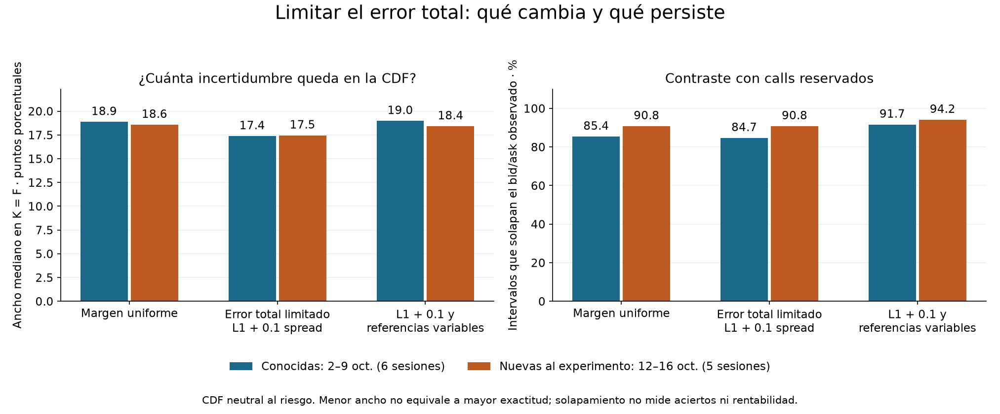
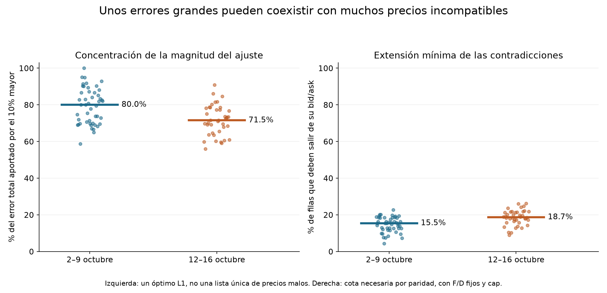

# QuantileFlow: error concentrado y contraste con otras sesiones

Fecha de cierre: 26 de octubre de 2026. Protocolo fijado el 22 de octubre.
Presupuesto de datos: **USD 0**. Continuación del camino B.

## Pregunta y diseño

El experimento anterior permitía ampliar todos los bid/ask según la cotización
que más reparación necesitaba. Eso podía conceder demasiada libertad a precios
que no la necesitaban. Ahora preguntamos si limitar también el **error total**
identifica mejor la distribución.

No borramos cotizaciones ni elegimos una lista de outliers después de ver el
resultado. Para cada distribución admisible calculamos cuánto se aparta cada
precio teórico de su intervalo bid/ask, medido en spreads completos:

\[
e_i(Q)=\frac{\max\{bid_i-P_i(Q),\;P_i(Q)-ask_i,\;0\}}{ask_i-bid_i}.
\]

Se mantiene el mismo límite individual del estudio anterior,
`cap = mínimo minimax + 0.5`. Después se encuentra el menor error medio
posible sujeto a ese cap, `b*`, y se exige:

\[
0\leq e_i\leq cap,\qquad \frac1n\sum_i e_i\leq b^*+\delta.
\]

Los márgenes son **0.05, 0.1 y 0.5 spreads de error medio**, con 0.1 como caso
principal. Se fijaron antes de examinar los días nuevos. No son tolerancias
estimadas del proveedor ni intervalos estadísticos de confianza. L1 limita la
magnitud total: **no garantiza que solo unas pocas cotizaciones cambien**.

Una banda más estrecha es esperable por añadir una restricción. Por sí sola
no demuestra que el nuevo supuesto sea más verdadero. Por eso se contrasta
también con contratos reservados y con referencias económicas variables.

## Datos, separación y límites de la prueba

- Cohorte conocida: seis sesiones del 2–9 de octubre; 12 capturas, cuatro
  vencimientos por captura, 48 combinaciones y 5,912 filas de entrenamiento.
- Cohorte nueva para estos experimentos: cinco sesiones del 12–16 de octubre;
  10 capturas, cuatro vencimientos por captura, 40 combinaciones, 4,582 filas
  de entrenamiento y 2,351 reservadas. Se excluyeron 409 filas por IV no finita,
  conforme al preprocesamiento heredado.
- Se reconstruyeron las tablas desde el crudo privado: **37 manifiestos y 136
  archivos únicos** pasaron sus verificaciones de contenido. El repositorio de
  datos quedó fijado en `43b286c0df2de41d63d0475260517c01d6f36f54`.
- El protocolo se guardó en `bedbd5b` antes de examinar la cohorte nueva. La
  ejecución iniciada el 22 se completó el 26 tras corregir el registro local
  de la revisión Git. No se cambiaron fechas ni tolerancias por los resultados.

Estas son otras sesiones históricas del mismo proveedor, no una prueba
prospectiva ni una validación independiente de precios. Las combinaciones de
captura y vencimiento no son días independientes.

En los días nuevos se reutiliza el adaptador descriptivo: filtros de calidad,
IV finita y ventana amplia de log-moneyness ±0.10. La división central de
±0.03 reserva cada tercer strike; los strikes adicionales se asignan con la
misma regla anidada. Call y put del mismo strike quedan en el mismo grupo.
F se estima solo con pares de entrenamiento central y D usa la tasa del
protocolo existente. No se necesita ajustar SSVI para este estudio.

El preprocesamiento utiliza una referencia implícita de la cadena para
seleccionar filas e invertir IV. Por ello la reserva no es independiente de
todo ese preprocesamiento; sus precios no entran directamente en el LP ni en
la estimación central de F. Los bloqueos por feed indicativo y referencia
implícita/desfasada permanecen visibles.

## Construcción matemática y controles

Cada vencimiento tiene una medida no negativa, masa uno y media financiera
declarada. El soporte principal es `[0,2F]`. Los estados incluyen los strikes
y quiebres de las rampas y payoffs; se conserva la reducción exacta del
problema continuo para funciones continuas lineales por tramos.

Las rampas proporcionan cotas exteriores de la CDF; dos medidas discretas
proporcionan diferencias efectivamente alcanzables. No se presentan los
extremos discretos como extremos globales del indicador discontinuo.

Para variar simultáneamente F y D se usa `w=(D/D_ref)p`. En la CDF se transforma
a `p=w/sum(w)`, `t=1/sum(w)` y `z=e*t`: el presupuesto queda
`mean(z) <= b*t`. Así se normaliza la probabilidad correctamente sin confundir
masa descontada con masa total uno.

Controles: F±0.25%, tasa±1 punto porcentual, soporte hasta 4F y ancho de rampa
reducido de 0.25% a 0.125% de F. Los controles mantienen el **mismo presupuesto
absoluto** del caso principal; no recalibran una tolerancia para favorecerlos.
Cada vencimiento se estudia por separado, sin imponer una dinámica temporal
ni relaciones de calendario entre vencimientos.

## Resultados

**La hipótesis se confirma parcialmente: limitar el error total recorta los
casos extremos, pero la ambigüedad central sigue siendo grande y se repite
en la semana nueva. No basta con corregir unos pocos precios aislados.**

Los vencimientos efectivamente presentes abarcan unos **27–33 días**. Aunque
el adaptador permite 1–90 DTE, este estudio no aporta evidencia sobre todo
ese rango ni sobre opciones de muy corto plazo.

### Cuánto se estrechan las distribuciones

Anchura mediana de la banda exterior de `Q(S_T≤F)`, en puntos porcentuales:

| Supuesto de error | Conocidas, 48 combinaciones | Nuevas, 40 combinaciones |
|---|---:|---:|
| Margen uniforme | 18.88 | 18.58 |
| L1 mínimo + 0.05 | 15.65 | 14.13 |
| **L1 mínimo + 0.1, principal** | **17.38** | **17.46** |
| L1 mínimo + 0.5 | 18.88 | 18.58 |
| Principal con F/D variables | 18.98 | 18.42 |

En los días nuevos, el caso principal reduce el ancho mediano solo **1.12
puntos**, aproximadamente 6%. La mejoría de los casos extremos es mayor:
el ancho máximo baja de **43.94 a 24.46 puntos**; en las sesiones conocidas
baja de 48.72 a 26.93.

La incertidumbre no es solo un exceso conservador de las rampas: dos medidas
admisibles alcanzan diferencias de CDF de **17.04 puntos en mediana** en los
días nuevos y 16.75 en los conocidos. No identificamos una PDF única.

La sensibilidad al presupuesto es relevante: reducir el margen de 0.1 a
0.05 estrecha la banda, pero sería incorrecto escoger esa tolerancia únicamente
porque produce una imagen más precisa. Ninguna fue calibrada con una fuente
que nos revele el error verdadero de las cotizaciones.

### Cuántos precios están en conflicto

| Medida | Conocidas | Nuevas |
|---|---:|---:|
| Mínimo error medio L1, mediana en spreads | 0.183 | 0.351 |
| Error aportado por el 10% mayor, mediana en un óptimo L1 | 80.0% | 71.5% |
| Filas fuera del bid/ask en ese óptimo, mediana | 26.8% | 34.0% |
| Pares call/put incompatibles con F/D fijos | 859/2,704 (31.8%) | 829/2,054 (40.4%) |
| Mínimo de filas que deben ajustarse por paridad y cap | 884/5,912 (15.0%) | 851/4,582 (18.6%) |

El 10% mayor concentra buena parte de la **magnitud**, pero las contradicciones
se extienden a muchas filas. Las dos primeras proporciones de ajustes proceden
de un óptimo que puede no ser único; no señalan qué contratos están realmente
equivocados ni minimizan su número.

La última fila sí es una **cota necesaria bajo F/D fijos y el cap declarado**:
cada par incompatible exige corregir al menos un lado; algunos requieren
ambos porque un solo lado agotaría su límite. Los pares son disjuntos por
strike, por lo que sus mínimos se suman. No se generaliza esta cota a cualquier
forward o descuento, y no prueba que el proveedor sea la única causa.

En la gráfica, cada punto representa una combinación de captura y vencimiento
y la línea es su mediana. Por ello 15.5%/18.7% de la gráfica no son exactamente
las proporciones agregadas 15.0%/18.6% de la tabla.

### Contraste reservado y sensibilidad económica

Se valoran tres calls reservados por vencimiento, seleccionados por cercanía
a K/F=0.97, 1 y 1.03, sin mirar sus precios al seleccionarlos.

| Medida | Conocidas: uniforme → L1 principal | Nuevas: uniforme → L1 principal |
|---|---:|---:|
| Intervalos que solapan el bid/ask reservado | 123/144 → 122/144 | 109/120 → 109/120 |
| Ancho medio por vencimiento, mediana en spreads | 4.54 → 4.26 | 6.34 → 5.31 |

En los días nuevos conservamos el mismo número de solapamientos con intervalos
algo más estrechos. Es útil, pero **11 de 120 contratos siguen sin solapar** y
las bandas de valoración continúan siendo amplias. Solapar no equivale a
acertar: la reserva es del mismo feed y una banda más amplia facilita hacerlo.

Permitir F/D variables aumenta el solapamiento nuevo a 113/120, a costa de
ampliar las bandas. Un extremo de la CDF puede cambiar hasta **9.81 puntos**
en los días nuevos por ese control económico; en los conocidos, hasta 10.00.
La referencia sigue importando.

Duplicar el soporte cambia los extremos como máximo 0.020 puntos en los días
nuevos y 0.025 en los conocidos. Reducir la rampa a la mitad puede cambiar un
extremo hasta 2.96 y 1.89 puntos respectivamente. Estos controles corresponden
a cinco umbrales prefijados; no certifican todo soporte o toda la CDF.

## Decisión y siguiente paso

**Conservaría L1+cap como diagnóstico, pero no lo promovería como una solución
para obtener probabilidades precisas o decidir compras.** Hemos mejorado el
tratamiento de casos extremos, no demostrado que reconstruimos la distribución
verdadera. Una red neuronal o un suavizado adicional pueden escoger una curva,
pero este experimento no justifica tratar esa elección como información nueva.

La siguiente prueba sin gasto puede volver a la pregunta original del proyecto:
**¿algún cambio entre 09:45 y 10:00 persiste para todas las distribuciones que
permiten los datos?** Se deben comparar el mismo vencimiento y umbrales de
precio absolutos, manteniendo una referencia común; comparar directamente
K/F de cada foto mezclaría cambios de la distribución con cambios de F.

Primero calcularía bandas para el cambio de CDF. Si una banda incluye cero,
ese cambio no queda identificado bajo el supuesto probado. Si lo excluye,
habría un candidato para estudiar, todavía sin afirmar dirección del retorno
ni rentabilidad. Una derivada de una PDF suavizada no sustituye este control.

Para atribuir los conflictos al feed o a la referencia hará falta además una
muestra independiente o referencia externa autorizada. Con presupuesto cero,
eso queda sujeto a encontrar acceso gratuito adecuado; comprar datos no es
un requisito para completar el contraste temporal anterior ni una garantía
de resolver toda la identificación. La captura actual continúa como está.

## Cómo se verificó

La suite conjunta pasa **46 pruebas**: 11 nuevas, 22 del experimento de ruido
uniforme y 13 de factibilidad. Incluye respuestas analíticas de paridad,
conservación de masa, presupuestos reconstruidos, límites de error, cambios
de escala, equivalencia con el margen uniforme y normalización con D variable.

El solver comprueba restricciones, condiciones duales y brecha de optimalidad.
Un segundo programa, sin volver a optimizar, reconstruye precios, masa, media,
errores por cotización, presupuestos, CDF y valoraciones reservadas desde las
medidas guardadas. También compara los conjuntos anidados y la reproducción
del caso uniforme publicado anteriormente.

Se resolvieron **16,192 LP** y se reconstruyeron sus 16,192 medidas guardadas,
88 reparaciones y **528 relaciones de inclusión**. Máximo error reconstruido:
3.42e−11 spreads en el cap, 4.87e−13 en el presupuesto medio y 1.96e−11 en los
objetivos. El caso uniforme reproduce el experimento B anterior en las
48 combinaciones conocidas. Estas comprobaciones validan la implementación,
no la veracidad económica de los supuestos de ruido.

Solo agregados y huellas se publican. Los precios individuales y medidas
completas permanecen fuera del repositorio público. No se modificaron la
captura operativa, el simulador A ni los estudios anteriores.

## Antecedentes y reproducción

La reparación de precios con programación lineal y cambios mínimos tiene
antecedentes en [Cohen, Reisinger y Wang](https://arxiv.org/abs/2008.09454).
El presupuesto medio, cap, controles, protocolo y evaluación de este ensayo
son decisiones propias; no una reproducción de sus resultados empíricos.

[Código y comandos](../experiments/ruido_concentrado_20261022/README.md) ·
[Protocolo congelado](../experiments/ruido_concentrado_20261022/protocolo.toml) ·
[Resumen numérico](../experiments/ruido_concentrado_20261022/resultados/resumen.json) ·
[Verificación independiente](../experiments/ruido_concentrado_20261022/resultados/verificacion.json).
