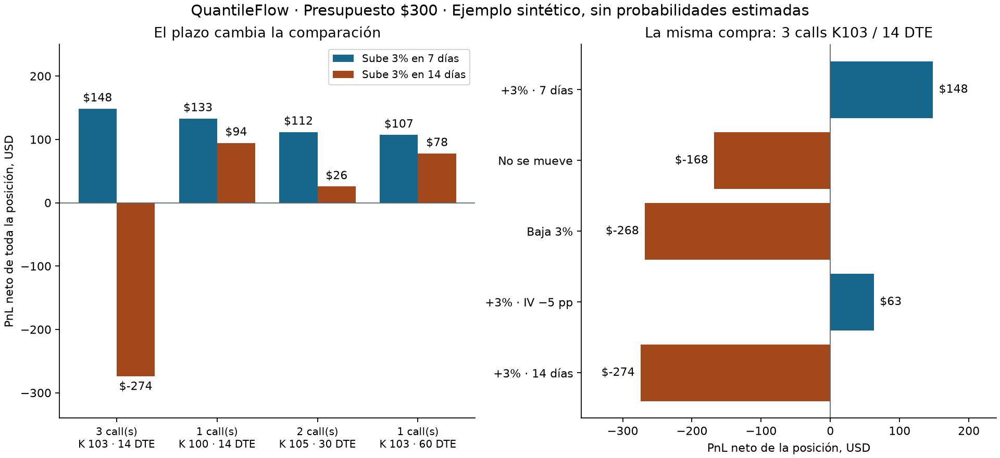

# QuantileFlow — camino A: simulador condicional
Fecha: 21 de octubre de 2026.

## Qué quedó hecho

Una aplicación local para contestar: «Si el subyacente se mueve X% en N días,
¿qué strike, vencimiento y cantidad generan más ganancia neta bajo mi presupuesto?».

Se reutiliza el flujo de caja del comparador anterior. Se agrega una interfaz,
validación de parámetros, superficie de ganancia/pérdida, escenarios de control,
sensibilidad a volatilidad y una comparación de ganadores vecinos. No se modifican
los experimentos históricos, sus fuentes ni la captura operativa.

Esta versión usa **12 calls europeos sintéticos**, sin comprar datos. El
presupuesto de $300 es capital ficticio de la posición, no gasto de datos.

## Resultado concreto

Ejemplo: spot $100, presupuesto $300, subida de 3% en 7 días, IV 25% constante,
tasa 4%, dividendo continuo 1.3%, semispread $0.04 por unidad por lado y comisión
$0.65 por contrato por lado. Días naturales desde la compra.

| Posición | Prima por contrato | Capital reservado | Efectivo libre | PnL objetivo |
|---|---:|---:|---:|---:|
| 3 calls K103, 14 DTE | $90.12 | $274.25 | $25.75 | +$148.35 |
| 1 call K100, 14 DTE | $204.33 | $205.63 | $94.37 | +$132.81 |
| 2 calls K105, 30 DTE | $117.86 | $238.33 | $61.67 | +$111.60 |
| 1 call K103, 60 DTE | $298.01 | $299.31 | $0.69 | +$106.93 |

El comparador considera **la posición completa**. Comprar varias opciones
baratas puede superar una cara en un escenario, pero también pierde más en otro.
El capital reservado incluye entrada y ambas comisiones; caja + reserva = $300.

Para la primera posición, manteniendo exactamente la misma compra:

| Qué ocurre al salir | PnL neto |
|---|---:|
| +3% en 7 días, IV sin cambio | +$148.35 |
| No sube en 7 días | −$168.05 |
| Baja 3% en 7 días | −$268.12 |
| +3% en 7 días, IV de 25% a 20% | +$63.05 |
| +3% en 14 días, justo al vencer | −$274.25 |

En el último caso, spot = strike = $103: el call vence sin valor. Acertar que
sube no basta; importan cuánto, cuándo y qué pasa con la IV.

Si la subida esperada baja a 2% en 7 días, gana el call K100/14 DTE.
Si ese 2% llega en 9 días, gana K103/60 DTE. Son cambios bajo supuestos,
no evidencia de capacidad predictiva. La matriz no es un porcentaje de confianza.

Las pequeñas diferencias respecto al demo PDE del 16 de octubre son esperables:
aquí se usa la fórmula analítica de Black–Scholes, sin error de malla. Por ejemplo,
el PnL anterior del primer candidato era aproximadamente $148.53. No cambiaron
las reglas de presupuesto ni los costos.

## Cómo se construye la superficie

Cada celda mantiene fija una compra y cambia dos entradas de salida:

1. Precio de salida del subyacente: S₁ = S₀ × (1 + movimiento).
2. Tiempo restante de la opción: (DTE − días transcurridos) / 365.
3. IV de salida: IV inicial + cambio absoluto de IV.
4. Valor europeo de salida: Black–Scholes con esas entradas.
5. Venta conservadora antes de vencer: max(valor − semispread, 0).
6. PnL = cantidad × (100 × venta − comisión) − desembolso inicial.

Al vencer se usa el payoff exacto, sin spread. Después de vencer la celda es
ausente, no cero. La reserva conservadora de comisión de cierre se conserva.

Así obtenemos una **superficie de PnL**, no una superficie de IV ni una densidad
de mercado. Los shocks de IV son explícitos. No se supone que la sonrisa real
permanezca plana ni que el precio de salida esté garantizado.

Las griegas muestran sensibilidad local al inicio de la posición. Los escenarios
grandes se recalculan completos; no se extrapolan solo con delta o gamma.

## Qué quedó verificado

Pasaron **65 pruebas focalizadas** en Windows (33 nuevas y 32 de los comparadores
existentes). La prueba de navegador real con Edge también pasó. Este conteo no
representa una nueva ejecución de toda la suite histórica del repositorio.

- Contabilidad contrastada con una fórmula normal independiente.
- Reserva de ambas comisiones, cantidades enteras, tope de riesgo y caja.
- Compra fija en la superficie; la fecha de salida no cambia la prima inicial.
- Payoff exacto al vencer, ausencia posterior y controles tardíos separados.
- Efectivo cuando no cabe una opción o todas pierden bajo el objetivo.
- IV imposible, cifras no finitas, parámetros desconocidos y tipos ambiguos.
- Primas sintéticas menores a $0.01/unidad excluidas explícitamente para evitar
  cantidades absurdas por precios numéricamente casi nulos.
- API local con archivos permitidos y rechazo de peticiones de origen ajeno.
- Puerto exclusivo: no reutilizar un puerto ocupado por otra aplicación.
- Navegador real: selección, presupuesto, descarga JSON, límite de cantidad,
  vencimiento, capital arriesgable cero, errores sin resultados anteriores y
  pantallas de 375 y 320 píxeles.

Los comandos reproducibles están en [la guía](../apps/simulador/README.md).
[El ejemplo JSON](../experiments/simulador_20261021/resultados/ejemplo.json) incluye
parámetros, escenarios y SHA-256 de fuentes con saltos de línea normalizados.
La figura usa los mismos resultados, sin servicios externos.

## Qué falta para pasar a contratos reales

El siguiente límite es la **validez de la entrada y del modelo para el instrumento**,
no que falte otra gráfica. Este ejemplo no demuestra que exista una cotización
ejecutable de $90.12 ni permite recomendar una compra.

Siguiente incremento propuesto, sin gasto de datos:

1. Admitir una cadena local con bid/ask, strike, vencimiento, multiplicador,
   estilo de ejercicio, timestamp, fuente y flags de calidad.
2. Aplicar filtros de ejecutabilidad y permitir abstención si la cadena no pasa.
   No reconstruir una PDF para hacer una comparación condicional básica.
3. Para acciones/ETF estadounidenses, comprobar el motor americano y sus
   dividendos discretos antes de compararlos con el europeo. Usar datos mejores
   no elimina este requisito de modelo.
4. Añadir shocks de sonrisa y costos de salida, y revisar si el ganador se
   conserva. No convertir esa estabilidad en probabilidad de éxito.
5. Más adelante evaluar combinaciones de series si se define un objetivo
   y restricciones de riesgo. La versión actual compara una serie a la vez.

El proyecto avanzó a una herramienta utilizable para escenarios. Sigue abierta
la investigación de PDFs incompatibles con las bandas originales; este producto
condicional no la da por resuelta.
