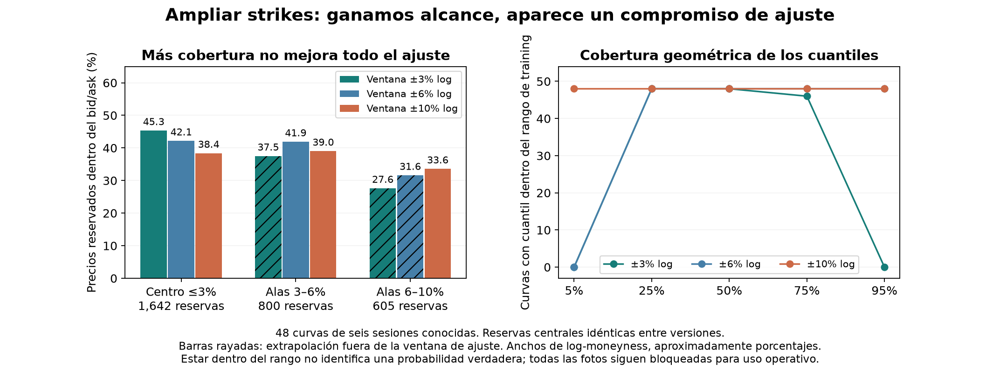

# QuantileFlow: ampliar strikes permite ver las colas, pero obliga a revisar el ajuste

14 de octubre de 2026. Presupuesto de datos **US$0**. Mismas seis sesiones conocidas
(2, 5, 6, 7, 8 y 9 de octubre), dos cortes diarios, 48 curvas de vencimiento.

El crudo existente sí contiene strikes que no usamos. Ampliar la ventana de
log-moneyness de ±3% a ±6% y ±10% permite ajustar **4,818 → 7,198 → 8,959** filas
sin aflojar los filtros. No son contratos únicos ni días independientes.

La superficie ampliada muestra una curva asimétrica con un mínimo y una subida
en el ala derecha, visible en el primer ejemplo cronológico. La pendiente descendente
del gráfico anterior era una vista de una franja estrecha de esa curva. Esta forma
es compatible con ejemplos de SVI/SSVI, pero la apariencia no valida el ajuste.

## El contraste principal: mismos precios reservados por región

| Ventana de ajuste | Centro ≤3%: 1,642 reservas | Alas 3–6%: 800 reservas | Alas 6–10%: 605 reservas |
|---|---:|---:|---:|
| ±3% | **744 / 45.31%** | 300 / 37.50% (*) | 167 / 27.60% (*) |
| ±6% | 692 / 42.14% | **335 / 41.88%** | 191 / 31.57% (*) |
| ±10% | 630 / 38.37% | 312 / 39.00% | **203 / 33.55%** |

Las cifras son cotizaciones reservadas dentro de su bid/ask. (*) Predicción del
modelo fuera de su ventana de ajuste: extrapolación diagnóstica. Ninguna de estas
cotizaciones se utiliza para calibrar o escoger inicializaciones.

Las reservas de cada región son idénticas entre versiones. Las regiones tienen
distintos denominadores: no comparar porcentajes como si fueran el mismo universo.
El ajuste amplio mejora las alas lejanas respecto de extrapolar desde el centro,
pero pierde **114** aciertos centrales, equivalentes a **6.94 puntos porcentuales**.
No hay una mejora uniforme. No elegimos una ventana para operar con estos resultados.

## Qué cambia en los cuantiles

| Ventana | 5% | 25% | 50% | 75% | 95% |
|---|---:|---:|---:|---:|---:|
| ±3% | 0/48 | 48/48 | 48/48 | 46/48 | 0/48 |
| ±6% | 0/48 | 48/48 | 48/48 | 48/48 | 48/48 |
| ±10% | 48/48 | 48/48 | 48/48 | 48/48 | 48/48 |

Son cuantiles del modelo dentro del intervalo mínimo–máximo de strikes de training,
no probabilidades identificadas, intervalos de confianza ni certificación de calidad.
Los huecos entre strikes permanecen. Tampoco se sustituyen los cuantiles ausentes del
contrato operativo: los cuantiles completos se conservan como diagnóstico privado.

La CDF cambia dentro del centro original hasta **2.23 puntos porcentuales** con ±6%
y **1.70 puntos** con ±10%, frente al ajuste nominal de ±3%. El máximo desplazamiento
de la mediana terminal es **7.59 bp** y **11.30 bp** del forward central, respectivamente.
Los máximos pueden ocurrir en curvas diferentes. Una ventana más grande no genera
una secuencia monotónica de esos máximos.

Comparación sobre el mismo eje de precio terminal `S_T/F_central`; cada modelo usa
su propio forward. Este ensayo mide conjuntamente el efecto de ampliar training,
reestimar el forward y recalibrar SSVI. **No identifica cuál de esos componentes
causa la pérdida central.** El forward cambia hasta 3.74/4.58 bp, respectivamente.

## Qué sabemos de los vencimientos

Cada foto guardada contiene cinco vencimientos SPXW: el que vence ese mismo día y
cuatro cerca de 30 días. Los cuatro usados abarcan aproximadamente **27.25–33.30 días**
en estas sesiones. La opción de vencimiento del día tiene alrededor de 0.25/0.30 días
restantes y queda excluida por el mínimo de un día de este ensayo.

Se buscó hasta 90 días en lo ya guardado: **no aparecen vencimientos intermedios o
largos adicionales**. Pedir un máximo de 90 al análisis no crea cotizaciones que la
captura nunca guardó. La configuración pide una ventana de contratos de 50 días,
pero selecciona vencimientos alrededor del objetivo de 30, además del cercano.
No tenemos una superficie amplia de plazos ni podemos validar 7/14/60/90 DTE con
estas fotos. El vencimiento del día requeriría un experimento independiente.

## Cómo protegimos la comparación

1. Verificamos las huellas de las tablas, sus 32 manifiestos y 163 páginas originales.
2. Se usa el adaptador y sus controles originales: sellos, edades, tamaños, spreads
   e inversión de IV con la referencia declarada. No se recuperan filas descartadas
   para conseguir alas más extensas. Dentro de la ventana amplia se excluyeron 714
   filas sin inversión de IV bid/mid/ask finita. Es una selección condicionada por
   esa referencia; no un inventario de toda la información utilizable del crudo.
3. Conservamos las **4,818 filas centrales originales**, precios y flags intactos.
   Las filas nuevas se reservan por strike: cada tercero entre los extras ordenados
   por vencimiento, con call/put en el mismo grupo. La asignación se fija en la ventana
   máxima y luego se recorta: los splits de ±6%/±10% son anidados y no cambian al
   reordenar las filas. No se reinicia la cuenta de cada tercer strike en cada ventana.
4. Se estima F exclusivamente con pares C/P de training. SSVI tiene tres inicios fijos,
   selección por costo de training y las condiciones suficientes originales de
   ausencia de arbitraje. El ajuste de ±3% se reutiliza y reproduce **744** aciertos.
5. Se comprueba `g >= 0` y varianza total creciente en mallas de strike/plazo dentro
   del dominio dibujado. Estas mallas son controles numéricos adicionales; las
   condiciones analíticas de SSVI son el fundamento, no una malla por sí sola.

El optimizador produjo avisos de overflow durante exploraciones de candidatos en
una foto. Solo se admiten soluciones convergentes, de costo finito y con restricciones
cumplidas; las soluciones finalmente usadas y sus precios se verificaron aparte.
No se modificó el optimizador histórico para ocultar el aviso.

## Verificación, referencias y decisión

Las **tres pruebas nuevas** del split pasan: conservación histórica, pares sin fuga,
anidamiento, invariancia al orden y rechazo de entradas inconsistentes.
Un verificador con fórmulas independientes reproduce **26,877 precios** (training y
holdout en las tres versiones), **720 cuantiles**, todos los conteos y la cobertura.
Error máximo de precio: 1.82e-12; de CDF en cuantiles: 3.62e-12. Huellas registradas.
Esta comprobación numérica no convierte las probabilidades Q en pronósticos físicos.

Referencias para interpretar la forma: [Gatheral y Jacquier, figura 4 y condiciones
de SVI/SSVI](https://www.ma.imperial.ac.uk/~ajacquie/index_files/GJ%20-%20NoArbSVI.pdf#page=25)
y [ejemplos de SSVI de Jacquier](https://github.com/JackJacquier/SSVI).
Son referencias de metodología; no un patrón visual que se fuerce sobre los precios.
No se debe exigir que la IV aumente siempre con DTE: la restricción de calendario
se aplica a varianza total normalizada con los supuestos de carry correspondientes.

**Decisión:** mantener el nominal de ±3% como referencia histórica y las variantes
amplias como diagnóstico. Todavía no adoptar ±10% como superficie de confianza para
posiciones. Las doce fotos mantienen sus bloqueos de indicative/referencia implícita.

Siguiente contraste: repetir las ventanas amplias **con F central congelado** para
separar el efecto de la referencia y la forma; analizar incompatibilidad C/P por
región y comparar con el ajuste convexo sobre el universo amplio. El contraste actual
no demuestra si el conflicto viene del feed, la rigidez SSVI, la pérdida o el forward.
Después se congelarán reglas para días nuevos, sin usar estas sesiones como test nuevo.

No se cambiaron recopilación, configuraciones, workflows, etiquetas, normalización
ni reglas de posición. Para ampliar plazos en futuras capturas habrá que versionar
la selección y medir solicitudes, paginación, preparación y puntualidad en una prueba
separada. No es necesario comprar datos para efectuar los contrastes anteriores.
Cotizaciones, parámetros, forwards y el ejemplo de superficie permanecen fuera de Git.
