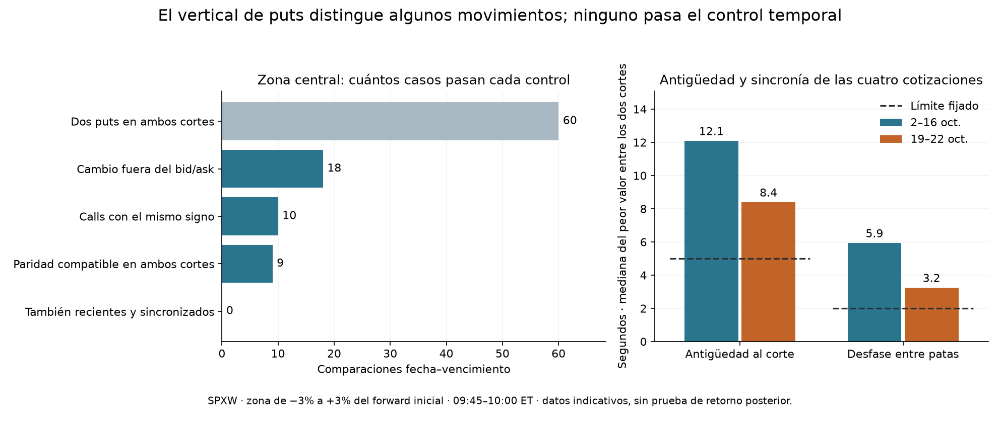

# Vertical de puts: qué cambió entre las 09:45 y las 10:00
**4 de noviembre de 2026 · SPXW europeo · USD 0 en datos.**

**Sí hay diferencias de precio que superan la horquilla de compra y venta.
Todavía no las usaría para gestionar una posición.** En la zona central, 18
de 60 comparaciones excluyen un cambio nulo. Nueve también coinciden con los
calls y son compatibles con paridad en ambos cortes, pero ninguna satisface la
regla temporal. Ninguna de las 60 comparaciones tenía cuatro patas suficientemente
recientes en ambos cortes: **el resultado limita lo que podemos medir; no prueba
que los movimientos sean falsos**.



## Qué cambió respecto al experimento anterior

Antes se acotaba la probabilidad de acabar por debajo de un nivel puntual,
para todas las distribuciones consistentes con una cadena **reparada**. Ahora
se observa una diferencia entre dos primas **sin reparar**. Para dos puts
europeos del mismo vencimiento, K bajo < K alto, el cociente

```text
[precio del put alto − precio del put bajo] / [descuento × (K alto − K bajo)]
```

es la probabilidad acumulada neutral al riesgo **promediada entre los strikes**
si los precios son coherentes. No es la probabilidad de acabar *dentro* de
la zona. Tampoco se interpreta como probabilidad física. La identidad sale de
integrar el pago del indicador sobre los strikes; véase la derivación para
puts europeos de [Allan Malz, NY Fed Staff Report 677](https://www.newyorkfed.org/medialibrary/media/research/staff_reports/sr677.pdf).
Una variación de este promedio no contradice el resultado anterior: se observa
otro pago y se aplican otros supuestos sobre los precios.

## Qué quedó fijado antes de medir

- Mismas once sesiones históricas del 2–16 de octubre y una réplica separada
  en las cuatro sesiones del 19–22 de octubre disponibles en el snapshot local.
  No son pruebas prospectivas ni independientes del proveedor.
- A las 09:45 se elige el put elegible más cercano a cada extremo objetivo.
  Desvío máximo: 0.5% del forward inicial; empate: menor strike. Zona
  principal −3% a +3%. Se exige el mismo vencimiento, identidad, strikes y
  multiplicador a las 10:00. No se busca un sustituto si una pata desaparece.
  Solo SPXW PM cerca de 30 días: ventana de 27–34 DTE en el primer corte.
- El forward inicial se estima con entrenamiento central. La selección de patas
  usa tanto contratos de entrenamiento como reservados elegibles: esto mide
  precios; no es una validación de un modelo ajustado con contratos reservados.
  Se heredan los filtros de calidad e IV finita de cada foto.
- La banda de prima por foto es [bid alto − ask bajo, ask alto − bid bajo].
  Para el cambio se resta el máximo inicial del mínimo final y viceversa. El
  descuento es el del propio corte. No se usan los puntos medios como precios
  de ejecución. La banda sin recortar se guarda en privado; si no intersecta
  [0,1], se registra como incompatible con una CDF en vez de producir una señal.
- Los calls permiten obtener la misma medida teórica por complemento. Requerimos
  el mismo signo y solapamiento de bandas de puts y calls en **ambos** cortes.
  No es una segunda fuente de mercado. Se pide además que las cuatro patas en
  cada foto tengan 0–5 s de antigüedad al corte nominal y que sus sellos de
  evento abarquen como máximo 2 s.
- La decisión pedía al menos dos **sesiones distintas** con un caso central
  corroborado en la réplica. Las zonas secundarias no sustituyen a la principal.

## Resultado central: cobertura completa, corroboración insuficiente

| Medida | 2–16 oct. | 19–22 oct. | Total |
|---|---:|---:|---:|
| Sesiones | 11 | 4 | 15 |
| Comparaciones fecha–vencimiento medibles | 44 | 16 | 60 |
| Cambios fuera del bid/ask: aumentos / descensos | 7 / 4 | 2 / 5 | 9 / 9 |
| Cambio compatible con cero | 33 | 9 | 42 |
| Calls y puts dan el mismo signo distinto de cero | 6 | 4 | 10 |
| Además, paridad compatible en ambos cortes | 6 | 3 | 9 |
| Además, cumplen antigüedad y sincronía | **0** | **0** | **0** |

El ancho mediano de la banda de cambio central fue **3.58 puntos porcentuales**.
El cambio absoluto del punto medio tuvo mediana de 0.98 puntos. Las medianas
describen el conjunto, no un umbral aplicado a cada caso. El signo de la
diferencia de primas antes de normalizar por descuento dio los mismos conteos.
Los cuatro vencimientos observados cada día no son cuatro sesiones independientes.

## Por qué falla el control temporal

Separando las dos condiciones, **0/60** pasan la antigüedad máxima de 5 s y
**3/60** pasan el desfase máximo de 2 s en ambas fotos. Tomando la peor foto
de cada par, las medianas fueron **11.12 s** para la antigüedad de la pata
más vieja y **5.32 s** para la separación entre los cuatro sellos. Por eso no
hay observaciones temporalmente elegibles con las que evaluar el poder
predictivo de esta señal.

La captura está configurada para iniciar las solicitudes 5 s antes del corte.
La última recepción de las cuatro patas ocurrió en mediana **4.52 s antes**
de la hora nominal. Como diagnóstico *posterior*, repetimos solo el control
temporal desde la última recepción de las cuatro patas de cada foto, sin cambiar
las cotizaciones ni la separación permitida. Pasan **3/60** (1 anterior y 2
adicionales); **ninguna de las nueve coincidencias coherentes** pasa. No se
reclasifican como confirmados los resultados del protocolo. Cambiar la etiqueta
de hora por sí solo no resuelve la falta de simultaneidad.

## Qué pasó con las otras zonas

| Zona respecto a F inicial | Medibles / previstas | Signo con puts | Mismo signo y paridad compatible | Pasan también tiempo |
|---|---:|---:|---:|---:|
| −6% a −3% | 60/60 | 21 | 0 | 0 |
| −3% a 0% | 60/60 | 23 | 2 | 0 |
| 0% a +3% | 60/60 | 9 | 2 | 0 |
| +3% a +6% | 0/60 | — | — | — |

En 56 de los 60 intentos de la última zona faltó un strike elegible a las
09:45 dentro de la tolerancia; en cuatro faltó una pata elegible a las 10:00.
Es **falta de cobertura**, no evidencia de cambio cero. Las zonas comparten
patas y capturas y no deben sumarse como señales independientes.

## Decisión

Dejaría la señal de 15 minutos **en observación** y no compraría datos a partir
de este resultado. Si en el futuro disponemos de cuatro patas contemporáneas
en suficientes sesiones, primero repetiremos la misma regla y solo después
contrastaremos retornos posteriores. Relajar los umbrales hasta que pasen las
nueve coincidencias no demostraría su utilidad.

La siguiente prioridad del proyecto es el simulador condicional: para un
movimiento, horizonte y presupuesto (por ejemplo, **US$300**), comparar
cantidades enteras de calls, efectivo remanente y pérdidas si el movimiento
llega tarde, no ocurre o cae la volatilidad. Este experimento no le transfiere
una probabilidad de ganar. No se cambió la captura ni se enviaron órdenes.

## Verificación

Protocolo congelado en `53939e9`. Para la réplica se verificaron **33 manifiestos
y 109 archivos únicos** del crudo. El auditor volvió a leer los Parquet, eligió
los strikes sin usar las 10:00 y enumeró **7,680 combinaciones bid/ask** en
los verticales disponibles de puts y calls. Revisó los 300 intentos, incluidos
los faltantes, y reprodujo los extremos sin discrepancia. Pasaron 19 pruebas
(10 del vertical y 9 del contraste temporal anterior).
[Código y reproducción](../experiments/vertical_puts_20261104/README.md) ·
[Resultados agregados](../experiments/vertical_puts_20261104/resultados/resumen.json) ·
[Auditoría y diagnóstico temporal](../experiments/vertical_puts_20261104/resultados/verificacion.json).
