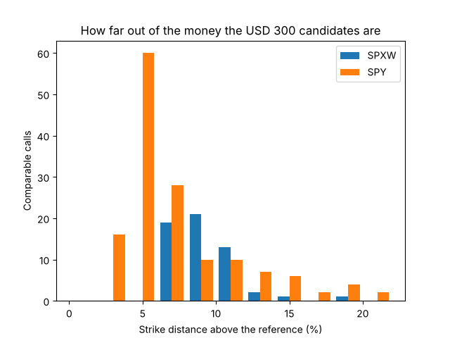
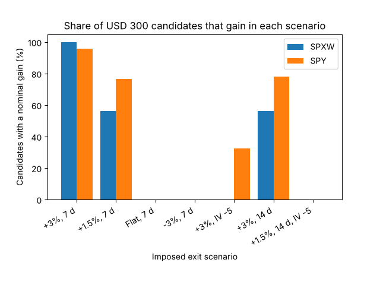
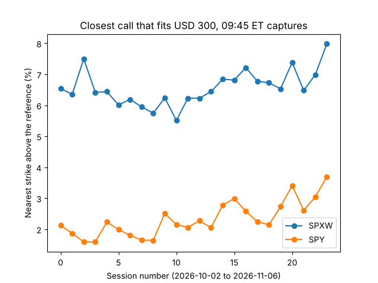
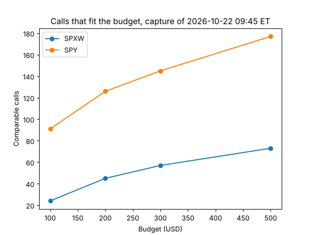

# Contratos observados con US$300: SPY frente a SPXW

**Fecha:** 12 de noviembre de 2026. **Captura:** 22 de octubre de 2026, 09:45 de Nueva York, la misma del
[informe de SPXW](CONTRATOS_OBSERVADOS_2026-11-06.md). **Estado:** exploratorio; ninguna compra habilitada.

Sigue el paso que dejó planteado ese informe: adaptar y validar SPY, con ejercicio americano y
dividendos, y ver si da contratos más adecuados para un presupuesto de US$300.

## Resultado

**SPY sí da contratos más adecuados al presupuesto, pero sigue sin haber una compra defendible.**

| | SPXW | SPY |
|---|---:|---:|
| Calls en la captura | 1 052 | 837 |
| Con calidad básica e IV | 659 | 621 |
| Que caben en US$300 y cubren siete días | 57 | 145 |
| Strike más cercano, por encima de la referencia | 6.8 % | 2.8 % |
| Strike mediano | 8.9 % | 5.9 % |
| Candidatos a menos de 5 % | 0 | 48 |
| Spread relativo mediano | 15.5 % | 4.1 % |
| Días al vencimiento | 28 a 33 | 22 a 39 |



Con SPXW, US$300 solo alcanzan para strikes lejanos. Con SPY, que vale la décima parte, alcanzan para
strikes a 3 % del precio. Eso cambia qué pasa cuando la hipótesis falla:

| Salida impuesta | SPXW: con ganancia, de 57 | SPY: con ganancia, de 145 |
|---|---:|---:|
| +3 % en 7 días, IV constante | 57 (57) | 139 (135) |
| +1.5 % en 7 días | 32 (22) | 111 (105) |
| Sin movimiento, 7 días | 0 | 0 |
| −3 % en 7 días | 0 | 0 |
| +3 % en 7 días, la IV cae 5 puntos | 0 | 47 (46) |
| +3 % en 14 días | 32 (28) | 113 (111) |
| +1.5 % en 14 días, la IV cae 5 puntos | 0 | 0 |

Entre paréntesis, las que también ganan en el extremo inferior de su banda de supuestos. **Son escenarios
impuestos, no probabilidades de ganar.**



Tres lecturas:

- **La subida a medias ya no borra la mayoría.** Con +1.5 % gana el 77 % de los candidatos de SPY, frente
  al 56 % de los de SPXW.
- **La caída de IV ya no lo borra todo.** Con +3 % y cinco puntos menos de IV, ningún SPXW gana; en SPY
  ganan 47, los más cercanos al dinero.
- **Sin movimiento, todos pierden.** Eso no cambia: son calls fuera del dinero comprados.

## Por qué todavía no hay una compra defendible

1. **El feed sigue siendo indicativo.** Alpaca modifica esas cotizaciones. En SPXW la comparación diaria
   con Robinhood muestra que sus puntos medios se apartan de un dato mejor; en SPY todavía no hay esa
   comparación.
2. **Solo un escenario separa un ganador.** Juntando las 202 compras de las dos raíces, en seis de los
   siete escenarios ninguna supera las bandas de todas las demás. La excepción es «+3 % y la IV cae 5
   puntos»: gana la compra de SPY más cercana al dinero. No basta: es una sola hipótesis, y las bandas de
   SPY son angostas porque sus spreads indicativos son de 1 a 9 centavos, justo el dato que falta
   contrastar.
3. **El ganador cambia si la subida tarda.** Con +3 % en 14 días gana otro contrato, igual que en SPXW.
4. **La dinámica de la IV sigue siendo un supuesto.** El choque paralelo es un escenario, no un modelo
   calibrado.

La referencia sí mejoró. La de SPX es implícita, sacada de la paridad. La de SPY es un precio observado: el
punto medio de IEX, 4.9 s antes del corte, con un spread de 0.016 %. Repetir todo con el bid y con el ask
de IEX no cambia ningún conteo. El consolidado (SIP), que llegó después y no entra en ningún cálculo, quedó
0.008 % por debajo.

## Cómo se valora SPY

Las opciones de SPY son americanas y SPY paga dividendos en efectivo. El adaptador hace esto:

- **Dividendos conocidos al corte.** Usa solo las versiones recibidas antes del corte y no retiradas. En
  esta foto había cinco dividendos pasados y ninguno declarado por venir.
- **Dividendos sin declarar: no se adivinan.** Con la cadencia conocida (el último fue el 18 de
  septiembre; nunca menos de 90 días entre dos) y un margen de siete días, el siguiente no puede caer
  antes del 10 de diciembre. Un contrato que venza ese día o después se excluye. Los cuatro vencimientos de
  SPY de la foto (13 a 30 de noviembre) quedan antes.
- **Sin dividendo en la vida del contrato, el call americano vale lo que el europeo.** No conviene ejercer
  antes (Merton, 1973). Se usa Black–Scholes sin dividendo y tasa de 4 %, supuesta.
- **Con un dividendo declarado, árbol binomial** de 400 pasos, con el dividendo en depósito. Ese camino
  está probado con datos sintéticos; en esta foto ningún contrato lo usa.
- **La salida es vender.** No se simula ejercer: con US$300 no se pueden recibir 100 acciones.

Lo demás es igual que en SPXW: mismos filtros de calidad, compra al ask, US$0.65 por contrato y lado,
cantidad entera limitada por el tamaño publicado, y la misma banda de supuestos (IV de bid a ask y uno o
dos semispreads al salir).

## ¿Pasa solo ese día?

No. Se repitió el conteo en las 24 sesiones de desarrollo que tienen captura de las 09:45, del 2 de octubre
al 6 de noviembre. No se usaron sesiones posteriores ni rendimientos.

| En 24 sesiones | SPXW | SPY |
|---|---:|---:|
| Candidatos con US$300 (mínimo, mediana, máximo) | 7, 34.5, 107 | 86, 138.5, 169 |
| Strike más cercano (mínimo, mediana, máximo) | 5.5 %, 6.5 %, 8.0 % | 1.6 %, 2.2 %, 3.7 % |
| Candidatos a menos de 5 % (mediana) | 0 | 56 |
| Sesiones en que gana SPY en ambas medidas | — | 24 de 24 |



Las cuatro últimas sesiones ya pierden contratos por la regla del dividendo sin declarar, y SPY sigue
dando más candidatos y más cercanos.

Con el presupuesto pasa lo mismo: de US$100 a US$500, SPY siempre da más candidatos y más cercanos.



## Comprobaciones

- **Se reprodujo el resultado de Codex** con tablas reconstruidas aquí desde el crudo: los mismos 57
  candidatos, el mismo embudo y los mismos conteos por escenario. Después del cambio, el análisis de SPXW
  sale idéntico.
- **72 981 celdas de SPY** recalculadas con otra fórmula (`math.erf`), más 20 979 ausentes y 435
  inversiones de IV. Error máximo: 1.3e-9.
- **Árbol americano en los 145 candidatos:** la prima por ejercer antes es exactamente cero y el árbol
  converge al precio cerrado (error máximo de 0.006 dólares por acción con 400 pasos y 0.002 con 1 600).
- **Árbol con dividendo** contrastado con la fórmula cerrada de Roll–Geske–Whaley en cuatro casos: a menos
  de 0.004 con 400 pasos.
- **18 pruebas nuevas** (438 en total): convergencia, dividendos conocidos al corte, versiones, retiros,
  exclusiones, celdas fuera de dominio y la API.
- **Interfaz revisada en Chromium** en los dos modos: 57 compras de SPXW y 145 de SPY, comparación A/B,
  mapas, descarga, ausencia de candidatos y pantallas de 320 y 375 píxeles.
- **Huellas** de los manifiestos y de las páginas crudas, también de su contenido descomprimido.

## Límites

- Una foto principal y conteos en otras 23. No hay nada sobre rendimientos reales.
- Feed indicativo, sin contraste de SPY contra otro proveedor.
- Tasa de 4 % supuesta; la IV de cada contrato se invierte por separado, sin exigir coherencia entre
  strikes.
- Desde el 3 de noviembre, los vencimientos del 10 de diciembre en adelante se excluyen hasta que se
  declare el dividendo: del 3 al 6 de noviembre eso quitó entre 151 y 409 calls de SPY por sesión. Cada
  trimestre se pierde cobertura durante unas semanas.
- El camino con dividendo declarado no se ha ejercitado con datos reales.

## Qué sigue

1. **Medir las cotizaciones de SPY contra Robinhood**, como ya se hace cada día con SPXW. Es el límite que
   más pesa y no cuesta nada.
2. **Dividendo esperado.** Decidir si los contratos que cruzan el dividendo de diciembre se valoran con un
   monto estimado y una banda, en vez de excluirlos.
3. **Perturbar la dinámica de la IV** más allá del choque paralelo.

No se cambió la captura diaria, no se contrató ningún feed y no se envió ninguna orden.

## Uso

```text
python scripts/normalizar_alpaca.py --desde 2026-10-22 --hasta 2026-10-22 --datos RUTA_REPO_DATOS --salida RUTA_TABLAS
python scripts/simulador_opciones.py --tablas-observadas RUTA_TABLAS --fecha-observada 2026-10-22 --subyacente-observado SPY
```

Se abre en `http://127.0.0.1:8791/observadas`. Sin `--subyacente-observado` sigue mostrando SPXW.

- Adaptador: `quantileflow/observadas.py` (`call_americano`, `dividendos_al_corte`).
- Experimento: [`experiments/observadas_spy_20261112/`](../experiments/observadas_spy_20261112/README.md).
- Pruebas: `tests/test_observadas_spy.py`.

Los valores por contrato y los mapas quedan fuera de Git; aquí solo hay código, conteos y resúmenes.
