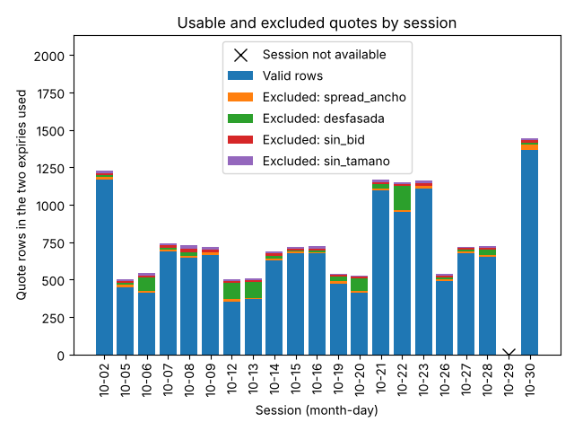
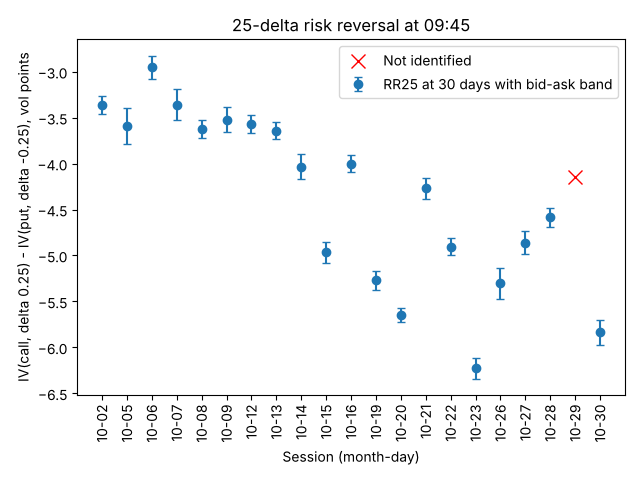
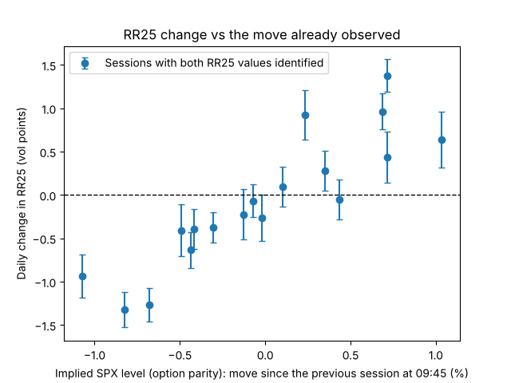
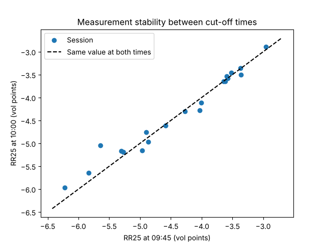

# Informe piloto de sesiones de apertura

- Configuración: `piloto-0.3` (huella `8d6dc48abb9f`); instrumento SPXW (europeo, liquidación PM), subyacente SPX.
- Corte principal 09:45 y secundario 10:00 (America/New_York); plazo constante de 30 días naturales; etiquetas a 1, 5 sesiones.
- Sesiones: 21, del 2026-10-02 al 2026-10-30.
- Fuentes: opciones alpaca/indicative; referencia de las opciones SPX alpaca/implicito_paridad_SPXW_indicative (inferido por paridad de las opciones); objetivo SPY alpaca/sip (observado).
- Entradas y hashes: `manifiesto.json`.

## Dictamen de datos

**Apto con limitaciones.**

| Criterio | Valor | Umbral | Cumple | Crítico |
|---|---:|---|---|---|
| Sesiones en la muestra | 21 | >= 20 | sí |  |
| RR25 a 30 días identificada a la hora principal | 0.952 | >= 0.9 | sí |  |
| Cambio diario de RR25 disponible | 0.900 | >= 0.8 | sí |  |
| Estabilidad 09:45-10:00 (mediana de la diferencia absoluta / ancho de banda) | 0.393 | <= 1.0 | sí |  |
| Sesiones con alertas de sincronía, edad o disponibilidad | 0.952 | <= 0.2 | no |  |
| Etiqueta del objetivo a 1 sesión disponible | 0.952 | >= 0.9 | sí |  |

Un criterio crítico incumplido hace el dictamen «insuficiente»; uno no crítico, «apto con limitaciones». Los umbrales están en la configuración y son provisionales.

**Alcance**, aparte de la aptitud de los datos:

- Medición: indicativa.
- Referencia de las opciones: inferido por paridad de las opciones.
- Precio objetivo: observado; instrumento: SPY, distinto de SPX: otro instrumento, con sus dividendos, gastos y diferencias de seguimiento.
- Rendimiento del objetivo: total: dividendos en efectivo sumados en su fecha ex; el de precio va aparte.
- Dividendos del objetivo: 23 consultas completas que pueden confirmar dividendos, la última recibida el 2026-10-30T14:29:19.110461+00:00. Cada etiqueta madura con la primera posterior a su fin que cubre el periodo (provisional). Queda aceptada bajo la política de 60 días (una regla, no una garantía de completitud) con una recibida después de ese margen, del último cambio de valor y de la última discrepancia resuelta, sin discrepancias abiertas. Con una discrepancia sin resolver (un dividendo ausente en una consulta comparable, uno cancelado por una resolución que el proveedor vuelve a traer con otros valores, o uno recibido sin fecha ex o sin monto que podría caer en el periodo) queda pendiente: solo la resuelve evidencia fechada.
- Rendimiento total a 1 sesión, por estado de sus dividendos: 20 provisionales, 0 aceptadas, 0 pendientes; con el valor revisado después de madurar: 0, y después de aceptarse: 0.
- Evaluación con precios de mercado: no permitida: cotizaciones indicativas, modificadas por el proveedor (alpaca/indicative).

## Calidad de los datos

- Sesiones procesadas: 20 de 21.
- No disponible el 2026-10-29: no hay vencimientos a ambos lados de 30 días.
- Exclusiones acumuladas a la hora principal: desfasada 782, spread_ancho 295, sin_bid 275, sin_tamano 275, ventana_de_apertura 18.
- Ancho mediano de spread: 13.0 ticks.
- Sesiones con alertas: 20.

## Señales

Convenciones: `RR25 = IV(call, delta +0.25) - IV(put, delta -0.25)` con delta forward sin descuento, `N(d1)` y `N(d1) - 1`; positivo significa mayor volatilidad en el call comparable. La asimetría a distancia logarítmica simétrica compara el call en `F * 1.03` con el put en `F / 1.03`. Ambas se interpolan a plazo constante en varianza total, pata por pata, y su banda sale de bid y ask. El cambio diario usa la sesión anterior del calendario, a la misma hora y plazo.

La relación visual entre cambios de RR25 y movimientos es exploratoria: este piloto no evalúa capacidad predictiva.

## Estabilidad entre 09:45 y 10:00

Mediana de |RR25(10:00) - RR25(09:45)|: 0.09 puntos; mediana del ancho de banda a las 09:45: 0.23 puntos.

## Tabla diaria

Completa en `tabla_diaria.csv` (hora principal) y `tabla_todas_las_horas.csv`. RR25 y cambios en puntos de volatilidad; rendimientos en porcentaje. El movimiento previo es de la referencia de las opciones (SPX, regla puntual); los rendimientos a 1 y 5 sesiones son totales del objetivo (SPY, regla histórica).

| Sesión | RR25 | Banda | Cambio | Asim. log | Válidas/filas | Alertas | Mov. previo ref. | Rend. 1 obj. | Rend. 5 obj. |
|---|---:|---|---:|---:|---|---:|---:|---:|---:|
| 2026-10-02 | -3.36 | [-3.46, -3.27] |  | -3.86 | 1165/1200 | 2 |  | -0.13 | 0.51 |
| 2026-10-05 | -3.59 | [-3.78, -3.40] | -0.23 | -3.86 | 450/480 | 2 | -0.13 | 1.03 | 1.07 |
| 2026-10-06 | -2.95 | [-3.08, -2.82] | 0.64 | -3.35 | 410/500 | 2 | 1.04 | -0.51 | -0.03 |
| 2026-10-07 | -3.36 | [-3.53, -3.19] | -0.41 | -3.78 | 687/716 | 2 | -0.49 | -0.00 | 0.08 |
| 2026-10-08 | -3.62 | [-3.72, -3.52] | -0.26 | -4.03 | 648/694 | 2 | -0.02 | 0.12 | -1.02 |
| 2026-10-09 | -3.52 | [-3.66, -3.39] | 0.10 | -4.01 | 662/698 | 2 | 0.10 | 0.43 | -0.44 |
| 2026-10-12 | -3.57 | [-3.67, -3.47] | -0.05 | -3.94 | 352/486 | 2 | 0.44 | -0.06 | -1.55 |
| 2026-10-13 | -3.64 | [-3.73, -3.55] | -0.07 | -4.30 | 368/484 | 2 | -0.07 | -0.40 | -1.80 |
| 2026-10-14 | -4.03 | [-4.17, -3.90] | -0.39 | -4.55 | 625/658 | 2 | -0.42 | -1.10 | -0.66 |
| 2026-10-15 | -4.97 | [-5.08, -4.85] | -0.93 | -5.14 | 677/698 | 2 | -1.07 | 0.69 | -0.03 |
| 2026-10-16 | -4.00 | [-4.10, -3.91] | 0.96 | -4.57 | 674/698 | 2 | 0.69 | -0.68 | -1.51 |
| 2026-10-19 | -5.27 | [-5.37, -5.17] | -1.27 | -5.39 | 475/510 | 2 | -0.68 | -0.32 | -0.60 |
| 2026-10-20 | -5.65 | [-5.72, -5.57] | -0.37 | -5.50 | 412/496 | 2 | -0.31 | 0.74 | 0.43 |
| 2026-10-21 | -4.27 | [-4.38, -4.15] | 1.38 | -4.50 | 1096/1130 | 2 | 0.72 | -0.46 | 0.04 |
| 2026-10-22 | -4.90 | [-4.99, -4.81] | -0.63 | -4.83 | 952/1124 | 2 | -0.44 | -0.78 | 0.28 |
| 2026-10-23 | -6.23 | [-6.34, -6.11] | -1.32 | -5.75 | 1109/1142 | 2 | -0.83 | 0.23 | -0.07 |
| 2026-10-26 | -5.30 | [-5.47, -5.13] | 0.92 | -5.02 | 492/516 | 2 | 0.23 | 0.71 |  |
| 2026-10-27 | -4.86 | [-4.99, -4.74] | 0.44 | -4.79 | 677/702 | 2 | 0.72 | 0.35 |  |
| 2026-10-28 | -4.58 | [-4.69, -4.48] | 0.28 | -4.82 | 652/702 | 2 | 0.35 | -0.23 |  |
| 2026-10-29 | no identificada |  |  |  | 0/0 | 0 |  | -1.13 |  |
| 2026-10-30 | -5.84 | [-5.97, -5.70] |  | -5.79 | 1365/1420 | 2 |  |  |  |

## Ejemplos

### Sesión normal

No hay ninguna en la muestra.

### Sesión problemática

**2026-10-02**: procesada; RR25 identificada.
Alertas: 2026-10-30: subyacente desfasado 6 s respecto del corte | 2026-11-02: subyacente desfasado 6 s respecto del corte.
Vencimiento 2026-10-30 (28.3 días): 955 de 974 filas válidas; exclusiones: desfasada 6, sin_bid 10, sin_tamano 10, spread_ancho 8.

| Strike | Tipo | k = ln(K/F) | Motivos |
|---:|---|---:|---|
| 8625 | call | +0.1049 | desfasada |
| 8650 | call | +0.1078 | spread_ancho |
| 8700 | call | +0.1136 | spread_ancho |
| 9000 | call | +0.1475 | spread_ancho |
| 9200 | call | +0.1695 | sin_bid, sin_tamano |
| 9400 | call | +0.1910 | desfasada, sin_bid, sin_tamano |

Vencimiento 2026-11-02 (31.3 días): 210 de 226 filas válidas; exclusiones: desfasada 6, sin_bid 6, sin_tamano 6, spread_ancho 10.

| Strike | Tipo | k = ln(K/F) | Motivos |
|---:|---|---:|---|
| 8600 | call | +0.1019 | spread_ancho |
| 8800 | call | +0.1249 | spread_ancho |
| 9000 | call | +0.1474 | desfasada, spread_ancho |
| 9200 | call | +0.1694 | desfasada, sin_bid, sin_tamano |
| 9400 | call | +0.1909 | desfasada, sin_bid, sin_tamano |
| 9600 | call | +0.2120 | desfasada, sin_bid, sin_tamano |

## Limitaciones

- El objetivo, SPY, es otro instrumento que el subyacente de las opciones (SPX): tiene sus dividendos, gastos y diferencias de seguimiento. Su precio es el mid de la última cotización válida en el corte: referencia estadística, no precio de ejecución.
- Las etiquetas auxiliares (`*_referencia`) son rendimientos del nivel de SPX inferido por paridad: diagnóstico de medición, no confirmación independiente de una predicción del índice publicado.
- Las etiquetas a 5 sesiones se solapan: no son observaciones independientes.
- La referencia del forward usa una tasa y un rendimiento de dividendo fijos de la configuración, no una curva con fuente.
- Los umbrales de calidad y del dictamen son provisionales hasta revisar este piloto.
- Hay sesiones sin hora de evento en las cotizaciones: en ellas la edad es desconocida y el control de desfase no se aplicó.
