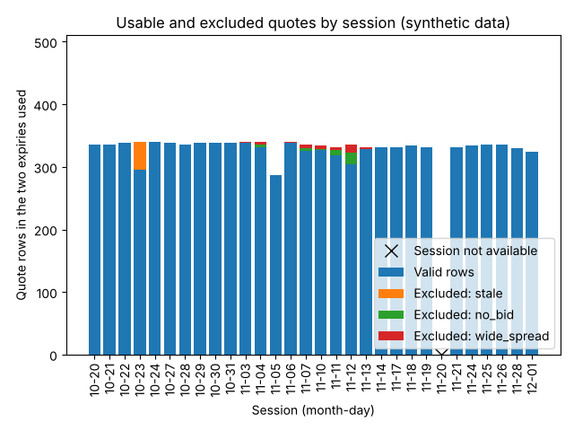
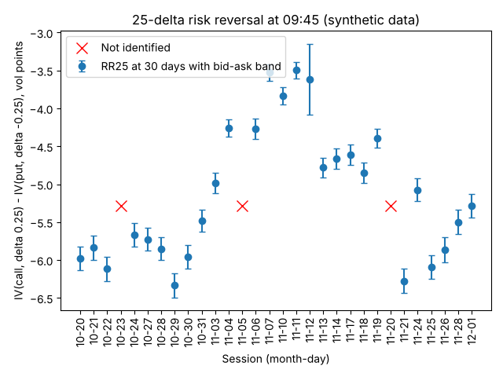
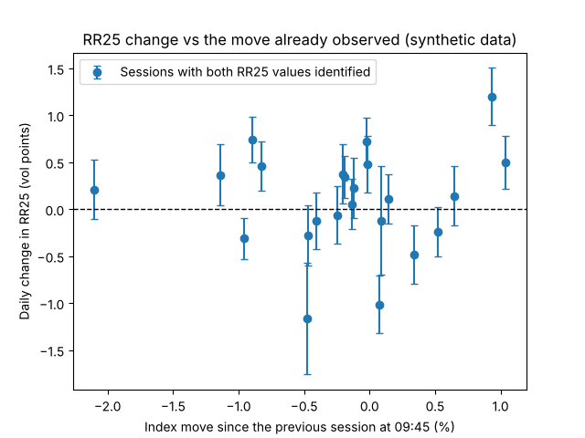
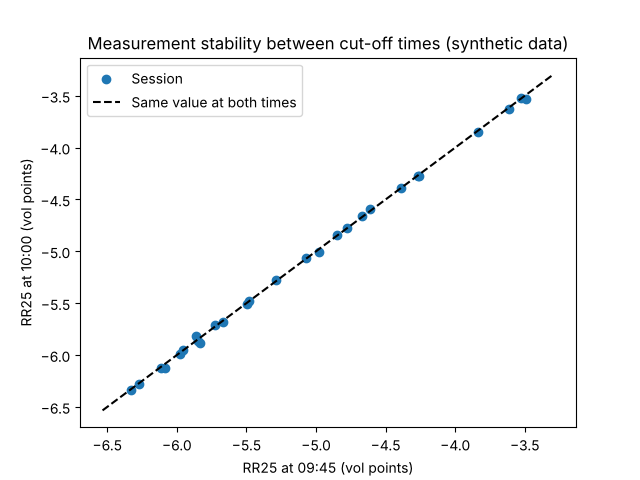

# Pilot report: template on synthetic data

> **SYNTHETIC DATA.** Generated by the code, not from the market: this document is the pilot report template. Its figures say nothing about SPX or about any signal.

- Configuration: `piloto-0.1` (fingerprint `a3815888b144`); instrument SPXW (european, PM settlement), underlying SPX.
- Primary cut-off 09:45, secondary 10:00 (America/New_York); constant maturity of 30 calendar days; labels at 1, 5 sessions.
- Sessions: 30, from 2025-10-20 to 2025-12-01.
- Inputs and hashes: `manifest.json`.

## Data verdict

**Usable with limitations.**

| Criterion | Value | Threshold | Met | Critical |
|---|---:|---|---|---|
| Sessions in the sample | 30 | >= 20 | yes |  |
| RR25 at 30 days identified at the primary cut-off | 0.900 | >= 0.9 | yes |  |
| Daily RR25 change available | 0.793 | >= 0.8 | no |  |
| Stability 09:45-10:00 (median absolute difference / band width) | 0.041 | <= 1.0 | yes |  |
| Sessions with sync, age or availability alerts | 0.067 | <= 0.2 | yes |  |
| 1-session label available | 0.933 | >= 0.9 | yes |  |

One unmet critical criterion makes the verdict “insufficient”; a non-critical one, “usable with limitations”. The thresholds live in the configuration and are provisional.

## Data quality

- Sessions processed: 29 of 30.
- Not available on 2025-11-20: no SPX price at the 2025-11-20 cut-off.
- Exclusions accumulated at the primary cut-off: stale 45, wide_spread 40, no_bid 38.
- Median spread width: 16.7 ticks.
- Sessions with alerts: 2.

## Signals

Conventions: `RR25 = IV(call, delta +0.25) - IV(put, delta -0.25)` with undiscounted forward delta, `N(d1)` and `N(d1) - 1`; positive means more volatility in the comparable call. The symmetric log-distance skew compares the call at `F * 1.03` with the put at `F / 1.03`. Both are interpolated to constant maturity in total variance, leg by leg, and their band comes from bid and ask. The daily change uses the previous calendar session, at the same cut-off and maturity.

The visual relationship between RR25 changes and moves is exploratory: this pilot does not evaluate predictive ability.

## Stability between 09:45 and 10:00

Median |RR25(10:00) - RR25(09:45)|: 0.01 points; median band width at 09:45: 0.30 points.

## Daily table

Complete in `daily_table.csv` (primary cut-off) and `all_cutoffs_table.csv`. RR25 and changes in volatility points; returns in percent.

| Session | RR25 | Band | Change | Log skew | Valid/rows | Alerts | Prev. return | Ret. 1 | Ret. 5 |
|---|---:|---|---:|---:|---|---:|---:|---:|---:|
| 2025-10-20 | -5.98 | [-6.14, -5.82] |  | -5.56 | 336/336 | 0 |  | 0.65 | 0.85 |
| 2025-10-21 | -5.84 | [-6.00, -5.68] | 0.14 | -5.46 | 336/336 | 0 | 0.65 | -0.47 | -0.21 |
| 2025-10-22 | -6.12 | [-6.28, -5.96] | -0.28 | -5.89 | 338/338 | 0 | -0.47 | 1.24 | 0.61 |
| 2025-10-23 | not identified |  |  |  | 295/340 | 0 | 1.24 | -0.32 | -0.83 |
| 2025-10-24 | -5.67 | [-5.82, -5.51] |  | -5.50 | 340/340 | 0 | -0.32 | -0.25 | -0.53 |
| 2025-10-27 | -5.73 | [-5.88, -5.58] | -0.06 | -5.74 | 338/338 | 0 | -0.25 | -0.41 | 0.76 |
| 2025-10-28 | -5.85 | [-6.00, -5.70] | -0.12 | -5.62 | 336/336 | 0 | -0.41 | 0.34 | 1.14 |
| 2025-10-29 | -6.33 | [-6.49, -6.17] | -0.48 | -6.02 | 338/338 | 2 | 0.34 | -0.20 | 0.57 |
| 2025-10-30 | -5.96 | [-6.11, -5.80] | 0.38 | -5.65 | 338/338 | 0 | -0.20 | -0.02 | 0.77 |
| 2025-10-31 | -5.48 | [-5.63, -5.33] | 0.48 | -5.71 | 338/338 | 0 | -0.02 | 1.04 | -0.11 |
| 2025-11-03 | -4.98 | [-5.11, -4.85] | 0.50 | -6.07 | 339/340 | 0 | 1.04 | -0.02 | -2.11 |
| 2025-11-04 | -4.26 | [-4.37, -4.14] | 0.72 | -5.85 | 332/340 | 0 | -0.02 | -0.23 | -2.28 |
| 2025-11-05 | not identified |  |  |  | 287/287 | 0 | -0.23 | -0.01 | -1.96 |
| 2025-11-06 | -4.27 | [-4.40, -4.14] |  | -5.63 | 339/340 | 0 | -0.01 | -0.89 | -2.43 |
| 2025-11-07 | -3.52 | [-3.63, -3.42] | 0.74 | -5.47 | 325/336 | 0 | -0.89 | -0.96 | -1.39 |
| 2025-11-10 | -3.84 | [-3.95, -3.72] | -0.31 | -5.47 | 327/334 | 0 | -0.96 | -0.19 | -0.57 |
| 2025-11-11 | -3.49 | [-3.60, -3.39] | 0.34 | -5.47 | 318/332 | 0 | -0.19 | 0.09 | 0.15 |
| 2025-11-12 | -3.61 | [-4.08, -3.15] | -0.12 |  | 304/336 | 0 | 0.09 | -0.47 | -0.77 |
| 2025-11-13 | -4.78 | [-4.91, -4.65] | -1.16 | -6.28 | 329/332 | 0 | -0.47 | 0.14 |  |
| 2025-11-14 | -4.67 | [-4.80, -4.53] | 0.11 | -5.68 | 332/332 | 0 | 0.14 | -0.14 | -0.19 |
| 2025-11-17 | -4.61 | [-4.74, -4.48] | 0.06 | -5.64 | 332/332 | 0 | -0.14 | 0.52 | 0.88 |
| 2025-11-18 | -4.85 | [-4.99, -4.72] | -0.24 | -5.63 | 334/334 | 2 | 0.52 | -0.83 | 0.43 |
| 2025-11-19 | -4.39 | [-4.52, -4.27] | 0.46 | -5.44 | 331/332 | 0 | -0.83 |  | 1.13 |
| 2025-11-20 | not identified |  |  |  | 0/0 | 0 |  |  |  |
| 2025-11-21 | -6.27 | [-6.43, -6.12] |  | -6.15 | 332/332 | 0 |  | 0.93 | -2.35 |
| 2025-11-24 | -5.07 | [-5.22, -4.93] | 1.20 | -5.12 | 334/334 | 0 | 0.93 | 0.08 | -5.01 |
| 2025-11-25 | -6.09 | [-6.24, -5.93] | -1.01 | -5.81 | 336/336 | 0 | 0.08 | -0.12 | -6.02 |
| 2025-11-26 | -5.86 | [-6.03, -5.70] | 0.23 | -5.49 | 336/336 | 0 | -0.12 | -1.14 | -5.76 |
| 2025-11-28 | -5.50 | [-5.66, -5.34] | 0.36 | -5.24 | 330/330 | 0 | -1.14 | -2.11 | -3.26 |
| 2025-12-01 | -5.29 | [-5.44, -5.13] | 0.21 | -4.99 | 324/324 | 0 | -2.11 | -1.72 | -1.23 |

## Examples

### Normal session

**2025-10-24**: processed; RR25 identified.
Expiry 2025-11-21 (28.3 days): 170 of 170 valid rows; exclusions: none.
Expiry 2025-11-28 (35.2 days): 170 of 170 valid rows; exclusions: none.

### Problematic session

**2025-10-23**: processed; RR25 not identified (expiry at 29.3 days: no span of valid puts crosses |delta| = 0.25).
Expiry 2025-11-21 (29.3 days): 147 of 170 valid rows; exclusions: stale 23.

| Strike | Type | k = ln(K/F) | Reasons |
|---:|---|---:|---|
| 5700 | put | -0.0203 | stale |
| 5690 | put | -0.0221 | stale |
| 5680 | put | -0.0238 | stale |
| 5670 | put | -0.0256 | stale |
| 5660 | put | -0.0273 | stale |
| 5650 | put | -0.0291 | stale |

Expiry 2025-11-28 (36.2 days): 148 of 170 valid rows; exclusions: stale 22.

| Strike | Type | k = ln(K/F) | Reasons |
|---:|---|---:|---|
| 5700 | put | -0.0208 | stale |
| 5690 | put | -0.0226 | stale |
| 5680 | put | -0.0243 | stale |
| 5670 | put | -0.0261 | stale |
| 5660 | put | -0.0278 | stale |
| 5650 | put | -0.0296 | stale |

## Limitations

- SPX returns are research labels: the index is not bought directly, and a policy on SPY or futures will need its own prices, costs and dividends.
- The 5-session labels overlap: they are not independent observations.
- The forward reference uses a fixed rate and dividend yield from the configuration, not a sourced curve.
- The quality and verdict thresholds are provisional until this pilot is reviewed.
- Some sessions have no event timestamp on the quotes: there the age is unknown and the staleness control was not applied.
